> doc-kind: manual
> doc-version: 1.0

<div align="center">

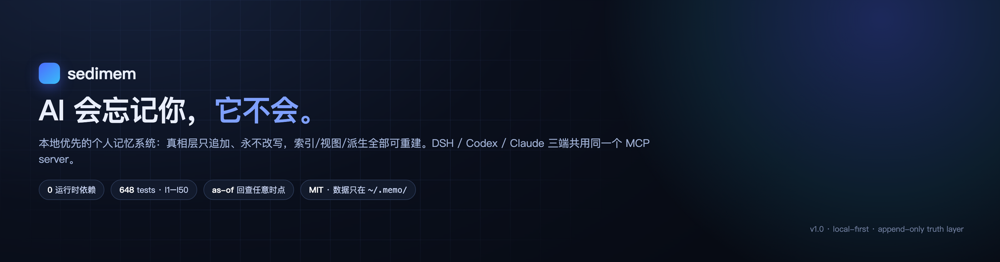

[中文](README.md) · **English**

[](https://github.com/Old-Friends-Gathering/sedimem/actions/workflows/ci.yml)
[](https://github.com/Old-Friends-Gathering/sedimem/actions/workflows/quality.yml)
[](https://github.com/Old-Friends-Gathering/sedimem/actions/workflows/security.yml)
[](https://github.com/Old-Friends-Gathering/sedimem/actions/workflows/pages-verify.yml)
[](LICENSE)
[](package.json)

**AI forgets you. This doesn't.**

- 🔒 **Immutable truth layer**: `~/.memo/items/<scope>.jsonl` is append-only, never edited in place. Fixing the past means appending a new version; query any point in time with `as-of`
- 🔌 **One memory, three clients**: DSH / Codex CLI / Claude Code all connect to the same stdio MCP server and the same store
- 🧱 **Zero deps, offline**: 12 modules, 0 runtime deps (Node ≥ 22, built-in `node:sqlite` FTS5); fully usable with no LLM at all

</div>

*This is a translation of [README.md](README.md); the Chinese version is authoritative and may be ahead.*

## What it is

sedimem is a local-first personal memory system for AI agents. All data lives on your machine under `~/.memo/`. The truth layer is append-only; indexes, views, and the LLM-derived layer can be wiped and rebuilt at any time. Memory settles like sediment instead of being overwritten.

Up and running in 30 seconds:

```bash
git clone https://github.com/Old-Friends-Gathering/sedimem && cd sedimem
NODE=$(command -v node); V=versions/$(cat versions/CURRENT)
$NODE $V/src/cli/memo.js write --kind fact --title "CI requires Node 22+" --text "Deploy pipeline requires Node 22 or newer" --agent cli
$NODE $V/src/cli/memo.js search "node version"
$NODE $V/src/cli/memo.js serve --port 7788   # Memory Hub at http://127.0.0.1:7788
```

> [!TIP]
> Try it without installing: `memo doctor` and `memo stats` are read-only. The Memory Hub is read-only by default; add `--write` to enable editing (token + If-Match guard against accidental writes).

## Why not the existing options

| Project | Strength | How sedimem differs |
|---|---|---|
| mem0 | Auto-extraction, cloud service | It relies on LLM extraction and rewriting; sedimem's truth layer is immutable — extraction only goes to a bypass derived layer |
| claude-mem | Auto memory in the Claude ecosystem | Claude-only; sedimem serves three clients through one stdio MCP server |
| dsh-engram | Windows support, graph panel | Similar graph-panel idea; sedimem adds as-of queries and auditable poisoning |
| supermemory | Cloud sync, cross-device | Cloud-centric; sedimem is deliberately local-first — delete `~/.memo/` and it's gone |
| DIY Markdown | Simple, controllable | No index, no dedupe, no conflict adjudication; sedimem has BM25 + semantic search and hygiene gates |

> [!NOTE]
> sedimem has no cloud sync and no multi-user permissions — deliberately absent, not missing.

## Architecture

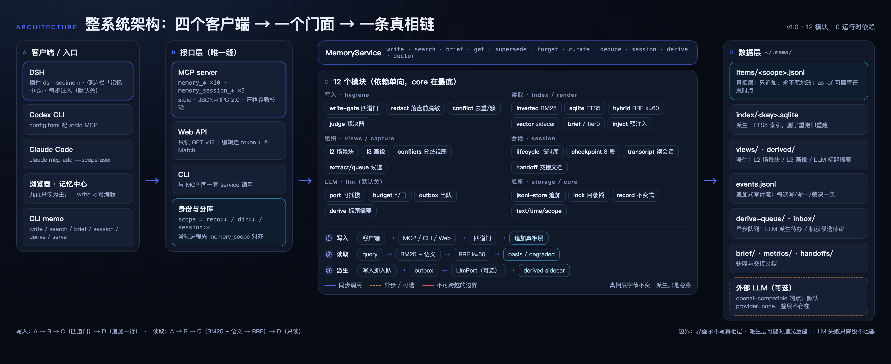

- **Three layers, one-way flow**: clients → interface layer (CLI / MCP / Web) → MemoryService → 12 modules (core / storage / index / hygiene / render / views / session / capture / llm / mcp / web / cli) → data layer; dependencies point only downward.
- **Four write gates**: schema validation → redaction (secrets / intranet domains / private paths → `[REDACTED:x]`, before anything hits disk) → dedupe (contentHash / entity keys / CJK bigram Dice, 0.15 recall, 0.85 match) → conflict (same slot, different value → superseded or disputed, with agent-as-judge adjudication).
- **Derived bypass**: LLM summaries go through outbox → sidecar (`derived/<scopeKey>.jsonl`); failures degrade only, and the truth layer stays byte-identical.

**The two main flows in detail**:

| 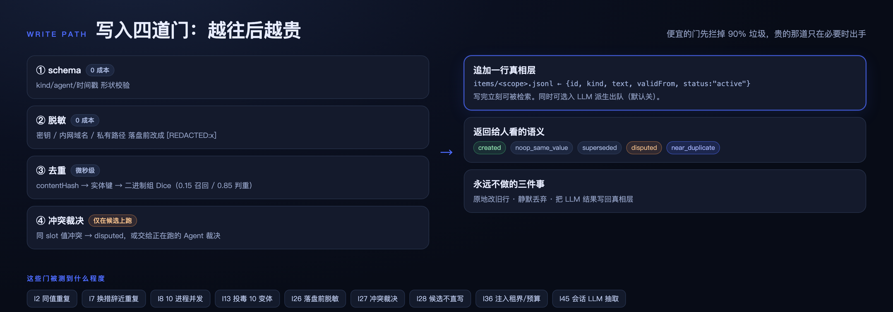 | 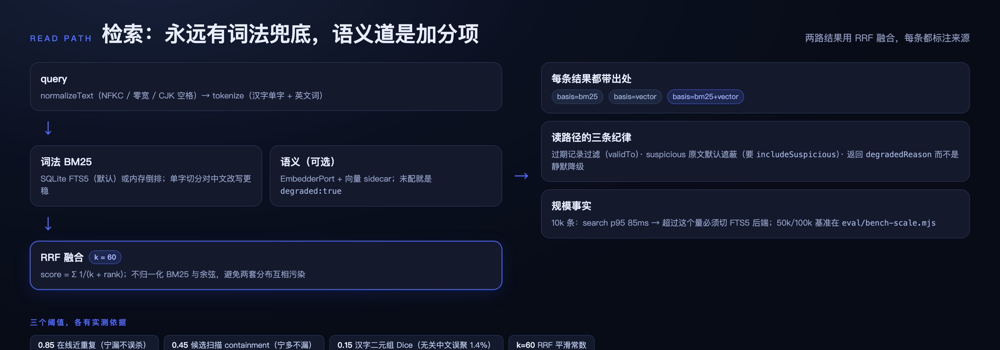 |
|---|---|
| Four write gates: each step costs more; cheap gates filter most noise | Dual-channel read: lexical always works, semantic degrades explicitly |

> [!NOTE]
> Diagrams are annotated in Chinese for now; English-annotated versions are tracked in issue #174.

> [!IMPORTANT]
> The truth layer (`~/.memo/items/`) is the sole authority: append-only, never edited in place. Indexes / views / derived data can be wiped and rebuilt with no fact loss.

## Features

| Capability | What it does | Command |
|---|---|---|
| Write | Passes the four gates in order, then appends | `memo write` |
| Search | BM25 (FTS5) ± semantic lane → RRF k=60; results carry basis; explicit degraded if semantic is down | `memo search` |
| Brief | Current-scope overview | `memo brief` |
| Hygiene | Dedupe scan, conflict adjudication, supersede, tombstone delete | `memo dedupe` / `curate` / `supersede` / `forget` |
| LLM derived | Bypass generation of title/summary/tags, off by default | `memo derive` / `llm` |
| Session scratch | Exploratory work goes to a scratch store first; close promotes via whitelist | `memo session` |
| Memory Hub | Nine-page Web UI, read-only by default | `memo serve --port 7788` |
| Doctor | Environment / store / index health checks | `memo doctor` / `stats` |
| Migrate & rebuild | Version-dir migration, full index rebuild | `memo migrate` / `reindex` / `compact` |

## Memory Hub

`memo serve --port 7788`, nine pages: Today / Graph / Search / Hygiene / Edit / Import / Session / Handoffs / Settings.

| 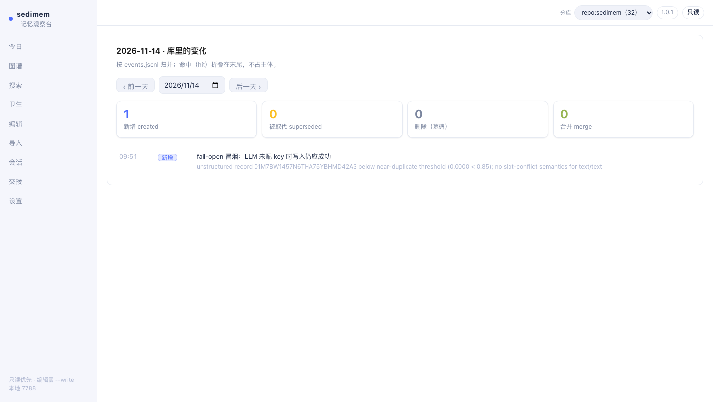 | 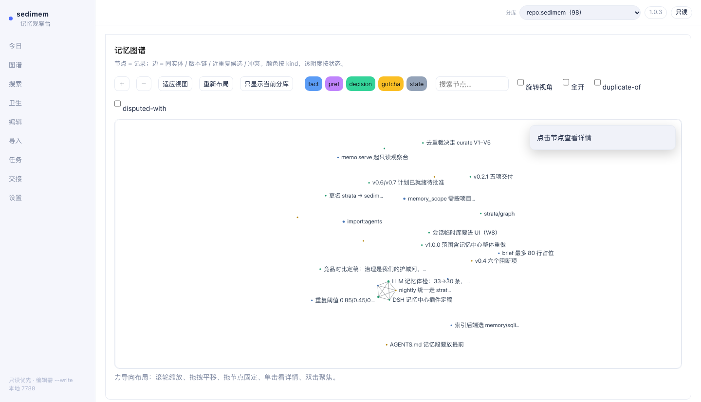 |
|---|---|
| 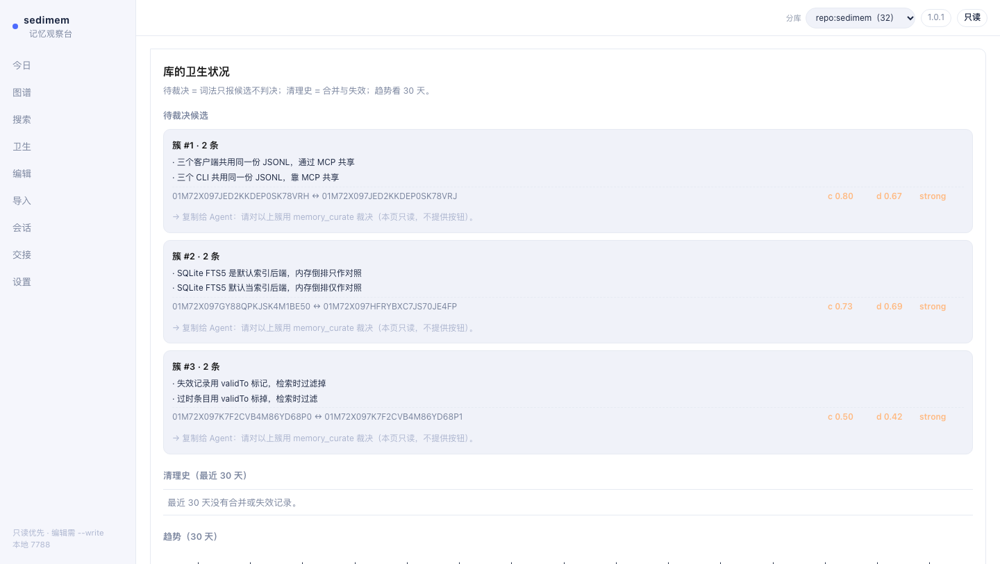 | 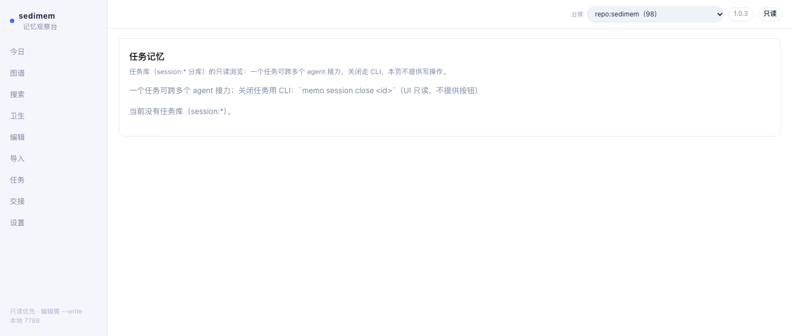 |

| Page | Purpose | Page | Purpose |
|---|---|---|---|
| Today | See today's changes | Edit | Change with `--write` mode on |
| Graph | Force-directed overview | Import | Bulk structured input |
| Search | Search with basis | Session | Scratch-store status |
| Hygiene | Pending-cluster cleanup | Handoffs | Six-section handoff docs |
| | | Settings | Store scope & theme |

## LLM summary layer (optional)

Default `provider=none` — the whole layer doesn't exist. When enabled, derived output goes only to the sidecar; the truth layer stays byte-identical.

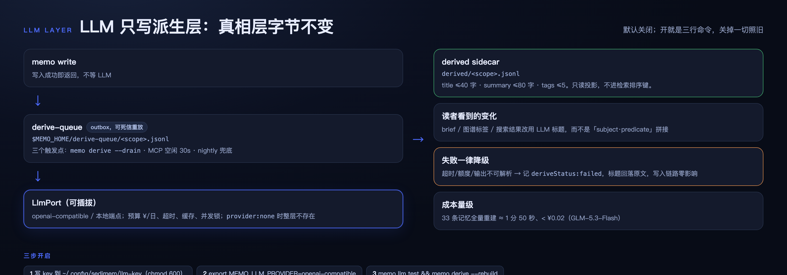

```bash
mkdir -p ~/.config/sedimem && printf '%s\n' '<key>' > ~/.config/sedimem/llm-key && chmod 600 ~/.config/sedimem/llm-key
export MEMO_LLM_PROVIDER=openai-compatible MEMO_LLM_BASE_URL=https://open.bigmodel.cn/api/paas/v4 MEMO_LLM_MODEL=glm-5.3-flash
memo llm status && memo llm test && memo derive --rebuild
```

Measured cost (GLM-5.3-Flash): full rebuild of 33 records ≈1m50s, **<¥0.02**; derive failures degrade only — writes and search are unaffected.

> [!NOTE]
> With LLM on, title/summary/tag generation requests go to your configured provider; raw memory text stays local, and the truth layer never participates in requests.

## Session scratch store

Exploratory work goes first into a `session:*` scratch store (fact writes forbidden). On close, only decision/gotcha entries are promoted to the main store (tagged `from-session:<id>`); the rest is discarded, and a six-section handoff doc is written to `docs/handoffs/<id>.md`.

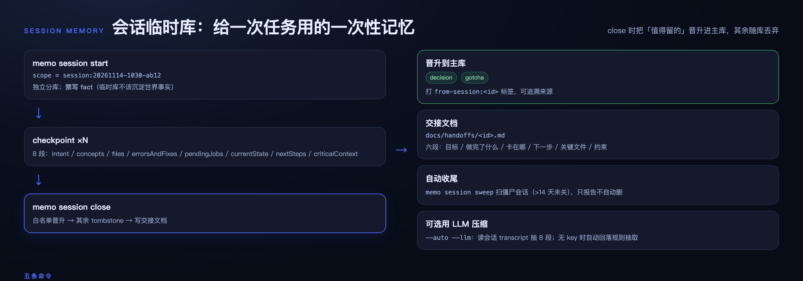

```bash
memo session start --title "Debug lock contention"
memo session checkpoint --intent "Find the root cause of lock contention"
memo session status
memo session close      # Promote + write handoff doc
memo session sweep      # Find zombie stores older than 14 days
```

<details>
<summary><strong>Connect three clients</strong></summary>

Each client gets one stdio MCP entry pointing at the same `server.js` and the same `MEMO_HOME`. For long-running processes (DSH), call `memory_scope` first to align the store scope.

```yaml
# DSH: ~/.dsh/profiles/<profile>/cordis.patch.yml
- insert:
    - id: memory-sedimem
      name: '@deepseek-ai/dsh-mcp-client'
      config:
        serverName: memo
        transport: stdio
        command: node
        args: ['/ABS/PATH/versions/v1.0/src/mcp/server.js']
        env: { MEMO_HOME: '$HOME/.memo' }
```

```toml
# Codex CLI: ~/.codex/config.toml
[mcp_servers.memo]
command = "node"
args = ["/ABS/PATH/versions/v1.0/src/mcp/server.js"]
enabled = true
[mcp_servers.memo.env]
MEMO_HOME = "$HOME/.memo"
```

```bash
# Claude Code
claude mcp add --scope user memo -e MEMO_HOME=$HOME/.memo -- \
  node /ABS/PATH/versions/v1.0/src/mcp/server.js
```

Self-check: `bash versions/v1.0/configs/verify-three-clients.sh` (expect `PASS`).

Tool surface: 10 `memory_*` + 5 `memory_session_*`, identical across all three clients.

</details>

<details>
<summary><strong>CLI & MCP cheat sheet</strong></summary>

| Command | What it does |
|---|---|
| `write` / `search` / `brief` / `get` | Write / search / brief / fetch one |
| `supersede` / `forget` | Replace with a new value / delete (tombstone by default) |
| `curate` / `dedupe` / `compact` | Adjudicate dedupe clusters / scan candidates / compact |
| `session` / `derive` / `llm` | Session scratch store / derive rebuild / LLM config |
| `serve` / `doctor` / `stats` | Memory Hub / health check / stats |
| `reindex` / `migrate` / `view` | Rebuild index / version migration / views |

| MCP tool | What it does |
|---|---|
| `memory_write` / `memory_search` / `memory_get` | Write / search / fetch one |
| `memory_brief` / `memory_stats` | Brief / stats |
| `memory_supersede` / `memory_forget` | Replace / delete |
| `memory_dedupe_scan` / `memory_curate` | Dedupe scan / adjudicate |
| `memory_scope` | View or switch store scope |
| `memory_session_*` (5 tools) | Scratch store start / checkpoint / status / close / sweep |

</details>

## Quality gates

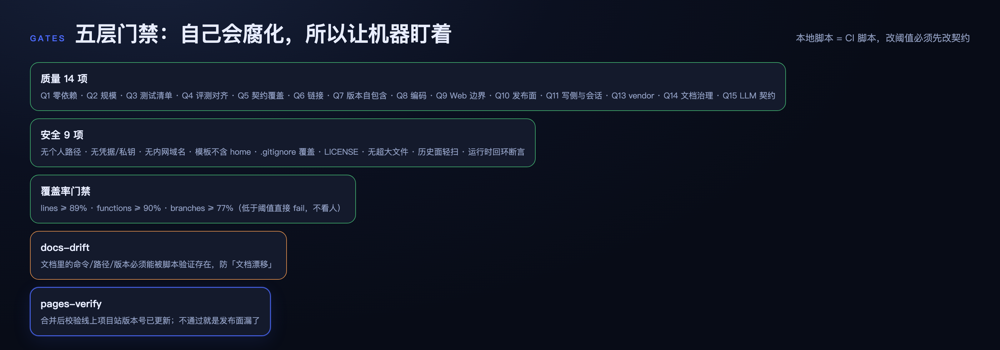

Local scripts = CI scripts: 14 quality checks + 9 security checks + coverage (lines ≥ 89 / functions ≥ 90 / branches ≥ 77) + docs-drift + pages-verify, plus 651 tests and eval I1–I50.

```bash
node tools/quality-check.mjs && node tools/security-check.mjs && node tools/coverage-gate.mjs
```

## Docs map

| Doc | What it covers |
|---|---|
| [docs/00](docs/00-principles-and-requirements.md) | Principles and hard requirements |
| [docs/01](docs/01-architecture.md) | Layering and failure modes |
| [docs/02](docs/02-data-model-and-contract.md) | **Data contract (sole authority)** |
| [docs/06](docs/06-usage.md) | Three-client setup and daily operations |
| [docs/07](docs/07-quality-and-security.md) | Gate metrics and thresholds |
| [docs/08](docs/08-web-ui.md) | Memory Hub nine-page spec |
| [docs/research](docs/research/README.md) | Why we built our own (8-system comparison) |

## Versions

| Version | Theme | Status |
|---|---|---|
| **v1.0.2** | Three real fixes (thinking chain / rebuild / lazy load) + doc diagram updates | ✅ Current |
| v1.0.1 | Graph usability + theme aligned with DSH | ✅ Shipped |
| v1.0.0 | 12-module refactor + LLM summary layer + nine-page rebuild | ✅ Shipped |
| Earlier (v0.1–v0.6) | Core layer, semantic lane, pages-verify, etc. | 🔒 Frozen |

`X.Y` gets a new directory; `X.Y.Z` patches in place. The pointer lives in `versions/CURRENT` (currently v1.0).

## FAQ

**Do I need an LLM?** No. `provider=none` is the default and fully functional; gates, search, brief, and graph all run at zero LLM cost.

**How much does LLM mode cost?** Negligible: full rebuild of 33 records <¥0.02, about 2 minutes; incremental drain is cheaper.

**Where does my data live?** Everything in `~/.memo/`. Delete the directory and it's completely gone — no cloud component; with LLM off, data never leaves your machine.

**How do three clients share one store?** Each gets one stdio MCP entry pointing at the same `server.js` and same `MEMO_HOME`; long-running processes align the scope with `memory_scope` first.

**Can multiple people use it?** scope is a categorization, not a permission boundary. Multi-user collaboration needs separate deployments and auth — deliberately out of scope.

**How is it different from mem0 / claude-mem?** They excel at auto-extraction; sedimem focuses on governance — three clients on one store + as-of queries + an immutable truth layer + auditable poisoning.

## Contributing

Issues and PRs welcome. Doc changes must update the contract (`docs/02`) in sync; the docs-drift gate will catch drift.

**In scope**: bug fixes, search and hygiene algorithm improvements, new CLI/Web capabilities (open an Issue first to align).

**Out of scope**: cloud sync, multi-user permissions, telemetry.

## Security

All data stays local in `~/.memo/` — no cloud components, no telemetry. Redaction happens before anything hits disk: secrets, intranet domains, and private paths are written as `[REDACTED:x]`. The Web UI is read-only by default; `--write` mode requires a token + If-Match. Report security issues via a security advisory first, not a public Issue.

## License

[MIT](LICENSE) © 2026 Old Friends Gathering
