> doc-kind: manual
> doc-version: 1.4

<div align="center">

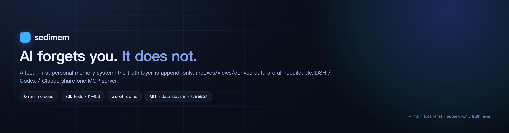

[中文](README.md) · **English**

📖 **Project site**: [English](https://old-friends-gathering.github.io/sedimem/en/) · [中文](https://old-friends-gathering.github.io/sedimem/)

[](https://github.com/Old-Friends-Gathering/sedimem/actions/workflows/ci.yml)
[](https://github.com/Old-Friends-Gathering/sedimem/actions/workflows/quality.yml)
[](https://github.com/Old-Friends-Gathering/sedimem/actions/workflows/security.yml)
[](https://github.com/Old-Friends-Gathering/sedimem/actions/workflows/pages-verify.yml)
[](LICENSE)
[](package.json)

**AI forgets you. This doesn't.**

- 🔒 **Immutable truth layer**: `~/.memo/items/<scope>.jsonl` is append-only, never edited in place. Fixing the past means appending a new version; query any point in time with `as-of`
- 🔌 **One memory, three clients**: DSH / Codex CLI / Claude Code all connect to the same stdio MCP server and the same store
- 🧱 **Zero deps, offline**: 14 modules, 0 runtime deps (Node ≥ 22.15, built-in `node:sqlite` FTS5); fully usable with no LLM at all

</div>

*This is a translation of [README.md](README.md); the Chinese version is authoritative and may be ahead.*

## What it is

sedimem is a local-first personal memory system for AI agents. All data lives on your machine under `~/.memo/`. The truth layer is append-only; indexes, views, and the LLM-derived layer can be wiped and rebuilt at any time. Memory settles like sediment instead of being overwritten.

Up and running in 30 seconds:

```bash
git clone https://github.com/Old-Friends-Gathering/sedimem && cd sedimem
NODE=$(command -v node); V=versions/$(cat versions/CURRENT)
$NODE $V/src/cli/memo.js write --kind fact --title "CI requires Node 22+" --text "Deploy pipeline requires Node 22 or newer" --agent cli
$NODE $V/src/cli/memo.js search "node version"
$NODE $V/src/cli/memo.js serve --port 7788   # Memory Hub at http://127.0.0.1:7788
```

> [!TIP]
> Try it without installing: `memo doctor` and `memo stats` are read-only. The Memory Hub is read-only by default; add `--write` to enable editing (token + If-Match guard against accidental writes).

## Why not the existing options

| Project | Strength | How sedimem differs |
|---|---|---|
| mem0 | Auto-extraction, cloud service | It relies on LLM extraction and rewriting; sedimem's truth layer is immutable — extraction only goes to a bypass derived layer |
| claude-mem | Persistent context across sessions, 6+ harnesses (incl. dsh) | Auto summaries (117k★, 6+ harnesses incl. dsh); sedimem serves three clients through one stdio MCP server with as-of and adjudication |
| dsh-engram | Windows support, graph panel | Similar graph-panel idea; sedimem adds as-of queries and auditable poisoning |
| supermemory | Cloud sync, cross-device | Cloud-centric; sedimem is deliberately local-first — delete `~/.memo/` and it's gone |
| DIY Markdown | Simple, controllable | No index, no dedupe, no conflict adjudication; sedimem has BM25 + semantic search and hygiene gates |

> [!NOTE]
> sedimem has no cloud sync and no multi-user permissions — deliberately absent, not missing.

## Architecture

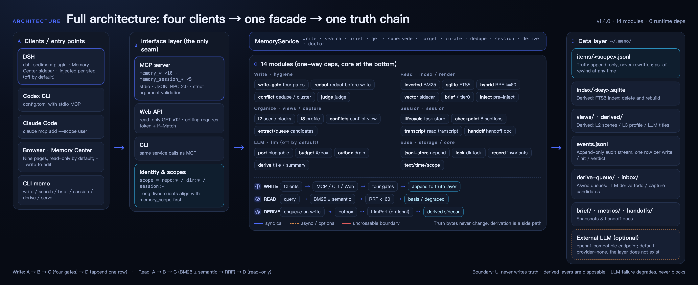

- **Three layers, one-way flow**: clients → interface layer (CLI / MCP / Web) → MemoryService → 14 modules (api / config / core / storage / index / hygiene / render / views / session / capture / llm / mcp / web / cli) → data layer; dependencies point only downward.
- **Four write gates**: schema validation → redaction (secrets / intranet domains / private paths → `[REDACTED:x]`, before anything hits disk) → dedupe (contentHash / entity keys / CJK bigram Dice, 0.15 recall, 0.85 match) → conflict (same slot, different value → superseded or disputed, with agent-as-judge adjudication).
- **Derived bypass**: LLM summaries go through outbox → sidecar (`derived/<scopeKey>.jsonl`); failures degrade only, and the truth layer stays byte-identical.

**The two main flows in detail**:

| 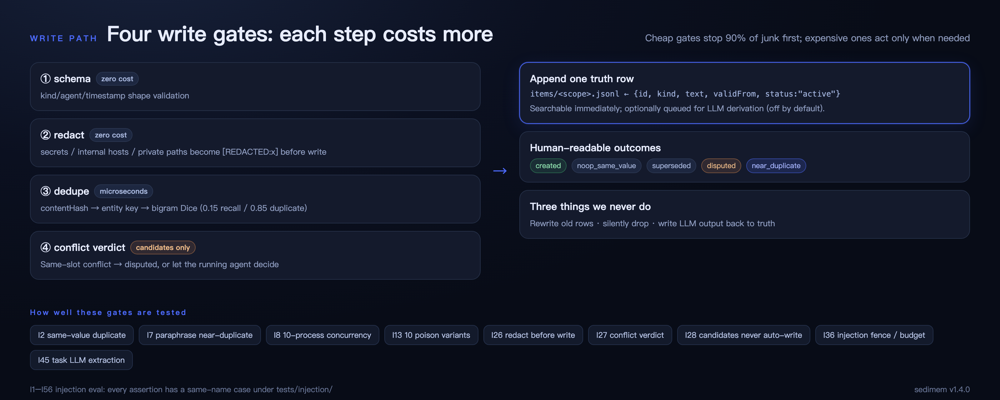 | 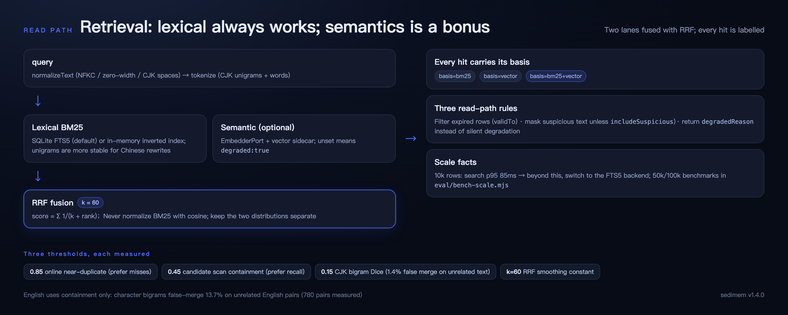 |
|---|---|
| Four write gates: each step costs more; cheap gates filter most noise | Dual-channel read: lexical always works, semantic degrades explicitly |

> [!NOTE]
> Diagrams are annotated in Chinese for now; English-annotated versions are tracked in issue #174.

> [!IMPORTANT]
> The truth layer (`~/.memo/items/`) is the sole authority: append-only, never edited in place. Indexes / views / derived data can be wiped and rebuilt with no fact loss.

## Features

| Capability | What it does | Command |
|---|---|---|
| Write | Passes the four gates in order, then appends | `memo write` |
| Search | BM25 (FTS5) ± semantic lane → RRF k=60; results carry basis; explicit degraded if semantic is down | `memo search` |
| Brief | Current-scope overview | `memo brief` |
| Hygiene | Dedupe scan, conflict adjudication, supersede, tombstone delete | `memo dedupe` / `curate` / `supersede` / `forget` |
| LLM derived | Bypass generation of title/summary/tags, off by default | `memo derive` / `llm` |
| Task store | Per-task scratch memory; close promotes via whitelist | `memo session` |
| Memory Hub | Nine-page Web UI, read-only by default | `memo serve --port 7788` |
| Doctor | Environment / store / index health checks | `memo doctor` / `stats` |
| Migrate & rebuild | Version-dir migration, full index rebuild | `memo migrate` / `reindex` / `compact` |

## Memory Hub

`memo serve --port 7788`, nine pages: Today / Graph / Search / Hygiene / Edit / Import / Task / Handoffs / Settings.

| 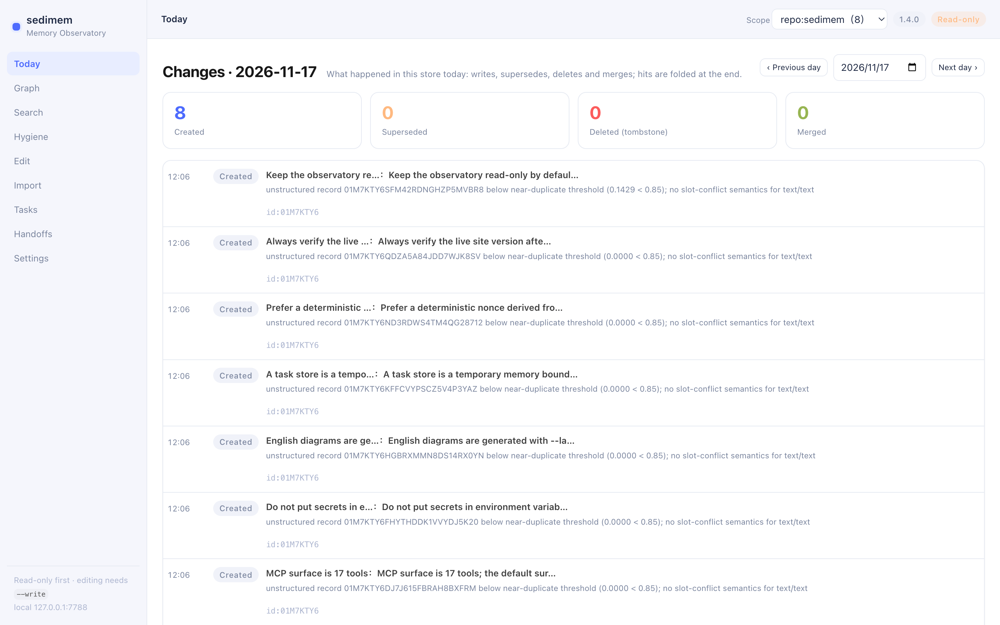 | 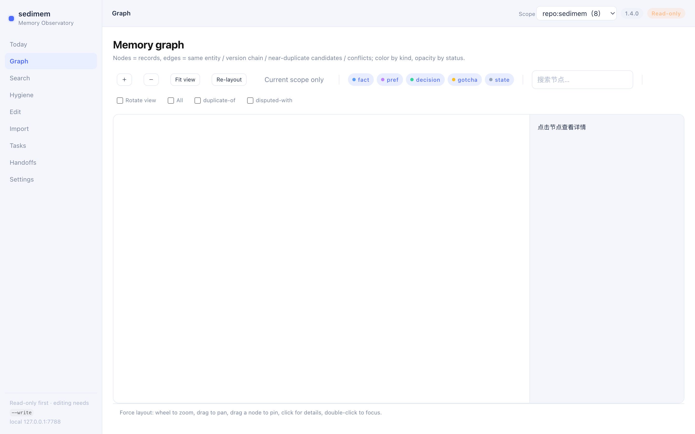 |
|---|---|
| 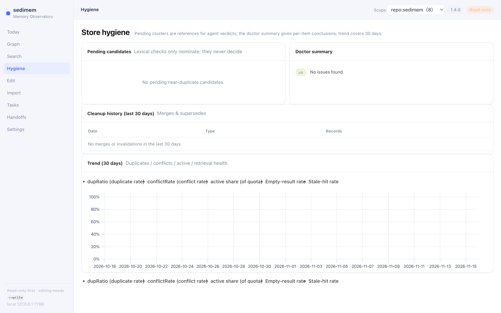 | 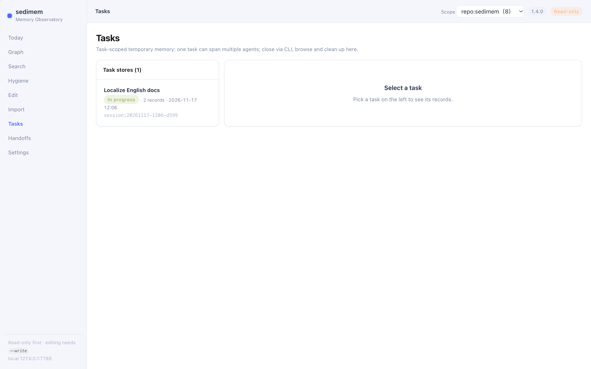 |

| Page | Purpose | Page | Purpose |
|---|---|---|---|
| Today | See today's changes | Edit | Change with `--write` mode on |
| Graph | Force-directed overview | Import | Bulk structured input |
| Search | Search with basis | Task | Task-store status |
| Hygiene | Pending-cluster cleanup | Handoffs | Six-section handoff docs |
| | | Settings | Store scope & theme |

## LLM summary layer (optional)

Default `provider=none` — the whole layer doesn't exist. When enabled, derived output goes only to the sidecar; the truth layer stays byte-identical.

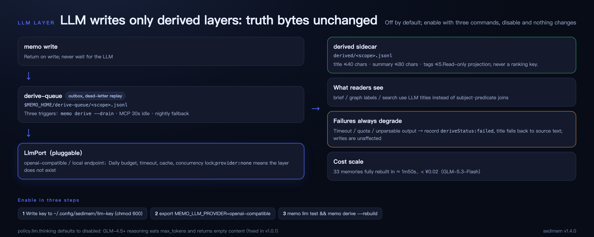

```bash
mkdir -p ~/.config/sedimem && printf '%s\n' '<key>' > ~/.config/sedimem/llm-key && chmod 600 ~/.config/sedimem/llm-key
export MEMO_LLM_PROVIDER=openai-compatible MEMO_LLM_BASE_URL=https://open.bigmodel.cn/api/paas/v4 MEMO_LLM_MODEL=glm-5.3-flash
memo llm status && memo llm test && memo derive --rebuild
```

Measured cost (GLM-5.3-Flash): full rebuild of 33 records ≈1m50s, **<¥0.02**; derive failures degrade only — writes and search are unaffected.

> [!NOTE]
> With LLM on, title/summary/tag generation requests go to your configured provider; raw memory text stays local, and the truth layer never participates in requests.

## Task store (scope `session:` )

A task's working state lives in a `session:*` store (fact writes forbidden). We key it by **task**, not by chat session: with multiple agents collaborating, one task spans several sessions and agents, so the task is the unit that gets handed off. On close, only decision/gotcha entries are promoted to the main store (tagged `from-session:<id>`); the rest is discarded, and a six-section handoff doc is written to `docs/handoffs/<id>.md`.

**Align the words first.** "Task store" has four neighbours; MCP only recognises this table.

| What you say | What it actually is | How to create / write |
|---|---|---|
| Task store / temporary memory / task context | `session:<id>`, task-scoped temporary memory; close promotes decision/gotcha | CLI `memo session start`; MCP `memory_session_start({title})` |
| Memory scope | `repo:<name>` / `dir:<name>`, long-lived project facts | `MEMO_SCOPE`; MCP `memory_scope({action:"use", path})` |
| Task board | DSH `task_board_*`, execution status only, no context | `task_board_create` |
| Task ledger | `segments` inside a task store (folded transcript) | `memo session capture` |

MCP default: when the user says "create a task store / create a task in the task store", call `memory_session_start({title})` first, then write directly with `memory_write({kind:"decision"|"gotcha"|"state", scope:"session:<id>"})` (no scope switch needed). Pass the same `scope` to `memory_session_checkpoint/status/close`; `close` restores the main scope automatically. Create `task_board_*` cards only for execution status; never create the task store as a `repo:`/`dir:` memory scope.

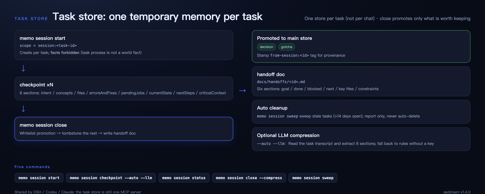

```bash
memo session start --title "Debug lock contention"
memo session checkpoint --intent "Find the root cause of lock contention"
memo session status
memo session close      # Promote + write handoff doc
memo session sweep      # Find zombie stores older than 14 days
```

## Task ledger (v1.2)

The task store keeps *conclusions*; the ledger keeps the *process*. Host compaction folds hundreds of thousands of tokens
into a few summaries — detail, your corrections, and dead ends are gone for good. The ledger folds the session transcript
into **replayable segments**, so nothing is lost when the session closes and you can expand the original text later.


| Capability | What it does | Command |
|---|---|---|
| Capture | Transcript → segments (range + anchor + summary + decisions/gotchas/files), idempotent ranges | `memo session capture` |
| Segments | List segments: range / rules or LLM / quarantined | `memo session segments` |
| Brief | A "context handoff" for the next agent (pack schema subset, ≤4000 chars) | `memo session brief` |
| Expand | Re-read the transcript via the anchor and restore the original text | `memo session expand --segment <id>` |
| Archive | Move the whole task to `archive/` (never a hard delete) | `memo session archive --yes` |

**Boundary**: segments live in `sessions/<taskId>/segments.jsonl` and **never** enter the memory truth layer — no quota,
no write gates, no facts, no main-store search. Text is redacted before it hits disk; segments that look like prompt
injection are quarantined and never reach the brief. If the LLM fails, capture falls back to rule extraction and
**never blocks** `close`.


<details>
<summary><strong>Connect three clients</strong></summary>

Each client gets one stdio MCP entry pointing at the same `server.js` and the same `MEMO_HOME`. For long-running processes (DSH), call `memory_scope` first to align the store scope.

```yaml
# DSH: ~/.dsh/profiles/<profile>/cordis.patch.yml
- insert:
    - id: memory-sedimem
      name: '@deepseek-ai/dsh-mcp-client'
      config:
        serverName: memo
        transport: stdio
        command: node
        args: ['/ABS/PATH/versions/v1.4/src/mcp/server.js']
        env: { MEMO_HOME: '$HOME/.memo' }
```

```toml
# Codex CLI: ~/.codex/config.toml
[mcp_servers.memo]
command = "node"
args = ["/ABS/PATH/versions/v1.4/src/mcp/server.js"]
enabled = true
[mcp_servers.memo.env]
MEMO_HOME = "$HOME/.memo"
```

```bash
# Claude Code
claude mcp add --scope user memo -e MEMO_HOME=$HOME/.memo -- \
  node /ABS/PATH/versions/v1.4/src/mcp/server.js
```

Self-check: `bash versions/v1.4/configs/verify-three-clients.sh` (expect `PASS`).

Tool surface: 10 `memory_*` + 5 `memory_session_*`, identical across all three clients.

</details>

<details>
<summary><strong>CLI & MCP cheat sheet</strong></summary>

| Command | What it does |
|---|---|
| `write` / `search` / `brief` / `get` | Write / search / brief / fetch one |
| `supersede` / `forget` | Replace with a new value / delete (tombstone by default) |
| `curate` / `dedupe` / `compact` | Adjudicate dedupe clusters / scan candidates / compact |
| `session` / `derive` / `llm` | Session scratch store / derive rebuild / LLM config |
| `serve` / `doctor` / `stats` | Memory Hub / health check / stats |
| `reindex` / `migrate` / `view` | Rebuild index / version migration / views |

| MCP tool | What it does |
|---|---|
| `memory_write` / `memory_search` / `memory_get` | Write / search / fetch one |
| `memory_brief` / `memory_stats` | Brief / stats |
| `memory_supersede` / `memory_forget` | Replace / delete |
| `memory_dedupe_scan` / `memory_curate` | Dedupe scan / adjudicate |
| `memory_scope` | View or switch store scope |
| `memory_session_*` (5 tools) | Scratch store start / checkpoint / status / close / sweep |

</details>


<details>
<summary>CLI cheatsheet (all subcommands)</summary>

| Command | What it does |
|---|---|
| `memo write --text "..." [--title "一句话标题"] [--kind fact] [--subject s] [--predicate p] [--agent dsh] [--value v] [--confidence 0.8] [--tags a,b] [--privacy private|shared] [--json]` | — |
| `memo search "..." [--limit 10] [--kind fact] [--as-of ISO] [--json]` | — |
| `memo brief [--lines 80] [--tier0]` | --tier0：一条一行的目录（≤800 字符，v0.3） |
| `memo view build|rebuild` | 重建 L2 场景块视图（纯派生，可删可重建） |
| `memo view show L2 [--limit 50] [--json]` | — |
| `memo view trace <recordId> [--json]` | 这条记录属哪个 L2 块 / 它是哪几条的派生（L3 溯源） |
| `memo view l3 plan [--json]` | L3 候选（预算上限来自 policy.l3） |
| `memo view l3 apply --file drafts.json` | 写入 L3（必须带 sourceRefs，一次 ≤ batchSize） |
| `memo get <id>` | — |
| `memo supersede <id> --value "..." [--text "..."] [--agent dsh] [--json]` | — |
| `memo forget <id> [--purge] [--reason "..."] [--json]` | — |
| `memo forget --source-agent <a> [--source-session <s>] [--content-hash <h>] [--reason "..."] [--dry-run]` | Delete by source: tombstone every scope, clean derived index/brief/ledger (B3) |
| `memo verify-delete --source-agent <a> [--source-session <s>] [--content-hash <h>] [--json]` | Verify items/index/vector/brief/ledger have no residue; exit 1 on any residue |
| `memo trust promote <id> --to T0|T1 --reason "..." [--drop-taint t1,t2] [--json]` | Human-only trust promotion (the only taint reduction), writes a trust_promote audit event |
| `memo stats [--json]` | — |
| `memo scope [--json]` | 看本目录解析出的分库（以及 MCP 侧覆盖文件） |
| `memo doctor [--json]` | — |
| `memo reindex` | — |
| `memo curate export [--limit 20]` | — |
| `memo curate prompt  [--limit N] [--json]` | 生成裁决任务包（docs/02 附录 B） |
| `memo curate auto    [--limit N] [--dry-run] [--json]` | 自动裁决（JudgePort，确定性无 LLM；裁决 50） |
| `memo compact        [--dry-run] [--grace 7d] [--json]` | 物理清理：只删 purge+过期的墓碑（裁决 51） |
| `memo curate status` | 列出批次与进度 |
| `memo curate apply   --file <任务包.json>` | 应用裁决（严格校验） |
| `memo curate apply <batchId> --decisions <file|->` | — |
| `memo dedupe scan [--threshold 0.45] [--dice 0.15] [--limit 50] [--json]` | 只读：近重复候选簇（裁决 22/23/26） |
| `memo dedupe apply --file decisions.json` | decisions.json: {batchId?, decisions:[{ids:[...]|pairIndex, decision, note}]} |
| `memo session start --title "..." [--repo <path>]` | 建临时会话库 session:<id>（v0.6） |
| `memo session checkpoint [--scope s] [--file ck.json] [--from-summary sum.json]` | — |
| `memo session status [--scope s] [--json]` | — |
| `memo session close [--scope s]` | 晋升 decision/gotcha + 交接文档 + 其余墓碑 |
| `memo session sweep [--older-than 14d] [--json]` | 只报告僵尸会话，不删 |
| `memo session list [--json]` | 任务库清单（标题/记录数/状态/时间/scope） |
| `memo session rename --scope session:<id> --title <t> [--json]` | 任务库改名（1..80 字符） |
| `memo session remove --scope session:<id> [--yes] [--json]` | 删任务库→trash/（无 --yes 仅预览，退出码 2） |
| `memo session capture --scope session:<id> [--llm] [--dry-run]` | 把该任务的对话折叠成段（规则模式零 token） |
| `memo session segments --scope session:<id> [--json]` | 列出段（区间/模式/可疑标记） |
| `memo session brief --scope session:<id> [--json] [--as-of ISO]` | 生成任务简报（pack schema 子集） |
| `memo session expand --scope session:<id> --segment <segId> [--to-file]` | 按锚点还原原文（仅本地） |
| `memo session archive --scope session:<id> [--yes]` | 归档整个任务目录 → archive/ |
| `memo migrate dsh-memory [--db path]` | — |
| `memo mcp [--surface core|all] [--session-tools]` | MCP server: default all (17 tools); `--surface core` keeps search/write/brief (3) |
| `memo inject [--max-chars N] [--allow-untrusted] [--no-audit] [--json]` | Build one injection and audit it as `kind:"inject"` (T2 body withheld by default) |
| `memo audit verify|anchor [--git] [--json]` | Verify the events.jsonl hash chain / write a local anchor (not tamper-proof vs same UID; no push) |
| `memo quarantine list|accept|reject [--ids a,b] [--by who] [--json]` | Quarantine stores references only; accept is human-only |
| `memo serve [--port N] [--no-ui]` | 只读 Web UI/API（默认 127.0.0.1:7788；--no-ui 只提供 API） |

</details>

## Quality gates

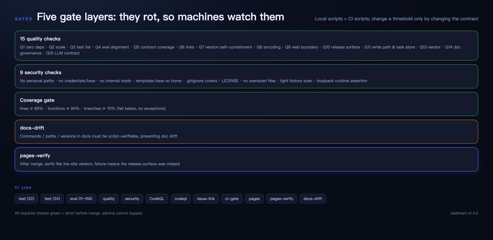

Local scripts = CI scripts: 15 quality checks + 9 security checks + coverage (lines ≥ 85 / branches ≥ 70 / functions ≥ 90) + docs-drift + pages-verify, plus 870 tests and eval I1–I56.

```bash
node tools/quality-check.mjs && node tools/security-check.mjs && node tools/coverage-gate.mjs
```

## Docs map

| Doc | What it covers |
|---|---|
| [docs/00](docs/00-principles-and-requirements.md) | Principles and hard requirements |
| [docs/01](docs/01-architecture.md) | Layering and failure modes |
| [docs/02](docs/02-data-model-and-contract.md) | **Data contract (sole authority)** |
| [docs/06](docs/06-usage.md) | Three-client setup and daily operations |
| [docs/07](docs/07-quality-and-security.md) | Gate metrics and thresholds |
| [docs/08](docs/08-web-ui.md) | Memory Hub nine-page spec |
| [docs/research](docs/research/README.md) | Why we built our own (8-system comparison) |

## Versions

| Version | Theme | Status |
|---|---|---|
| **v1.4.0** | P0b start: English README/site (English diagrams + `?lang=en` UI) and project-site links in both READMEs | ✅ Released |
| **v1.4.1** | Periodic auto-capture: scan open tasks every 60s, capture at 30k context without memory tool calls | ✅ Released |
| **v1.4.2** | Multi-session task stores: auto-register every developing session, watcher captures each session, no manual bind | ✅ Released |
| **v1.4.3** | Codex capture: `--codex` import + auto-register by id/cwd, segments marked `source.kind=codex` | 🚧 In progress |
| v1.3.1 | Task-store terminology & entry fix: MCP now says "task store = temporary memory = session:<id>"; `memory_write` accepts a one-shot `scope` | ✅ Shipped |
| v1.3.0 | P0a foundation: CI follows `versions/CURRENT`, coverage/Windows smoke de-hardcoded, engines 22.15 | ✅ Shipped |
| v1.2.x | Task context ledger (segments/brief/expand) + task page | ✅ Shipped |
| v1.1.x | Task library management + UI rebuild | ✅ Shipped |
| v1.0.x | Module refactor + LLM summary layer + nine-page rebuild | ✅ Shipped |
| Earlier (v0.1–v0.6) | Core layer, semantic lane, pages-verify, etc. | 🔒 Frozen |

`X.Y` gets a new directory; `X.Y.Z` patches in place. The pointer lives in `versions/CURRENT` (currently v1.3).

## FAQ

**Do I need an LLM?** No. `provider=none` is the default and fully functional; gates, search, brief, and graph all run at zero LLM cost.

**How much does LLM mode cost?** Negligible: full rebuild of 33 records <¥0.02, about 2 minutes; incremental drain is cheaper.

**Where does my data live?** Everything in `~/.memo/`. Delete the directory and it's completely gone — no cloud component; with LLM off, data never leaves your machine.

**How do three clients share one store?** Each gets one stdio MCP entry pointing at the same `server.js` and same `MEMO_HOME`; long-running processes align the scope with `memory_scope` first.

**Can multiple people use it?** scope is a categorization, not a permission boundary. Multi-user collaboration needs separate deployments and auth — deliberately out of scope.

**How is it different from mem0 / claude-mem?** They excel at auto-extraction; sedimem focuses on governance — three clients on one store + as-of queries + an immutable truth layer + auditable poisoning.

## Contributing

Issues and PRs welcome. Doc changes must update the contract (`docs/02`) in sync; the docs-drift gate will catch drift.

**In scope**: bug fixes, search and hygiene algorithm improvements, new CLI/Web capabilities (open an Issue first to align).

**Out of scope**: cloud sync, multi-user permissions, telemetry.

## Security

All data stays local in `~/.memo/` — no cloud components, no telemetry. Redaction happens before anything hits disk: secrets, intranet domains, and private paths are written as `[REDACTED:x]`. The Web UI is read-only by default; `--write` mode requires a token + If-Match. Report security issues via a security advisory first, not a public Issue.

## License

[MIT](LICENSE) © 2026 Old Friends Gathering
