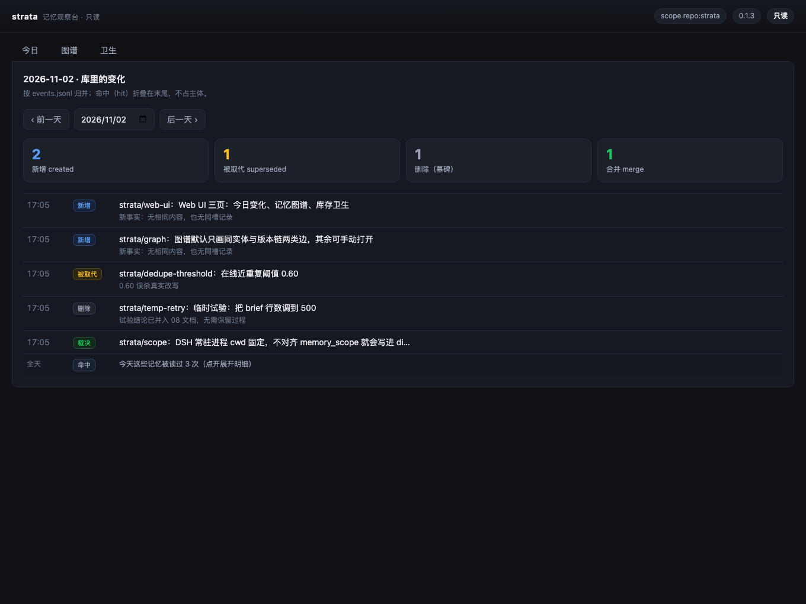
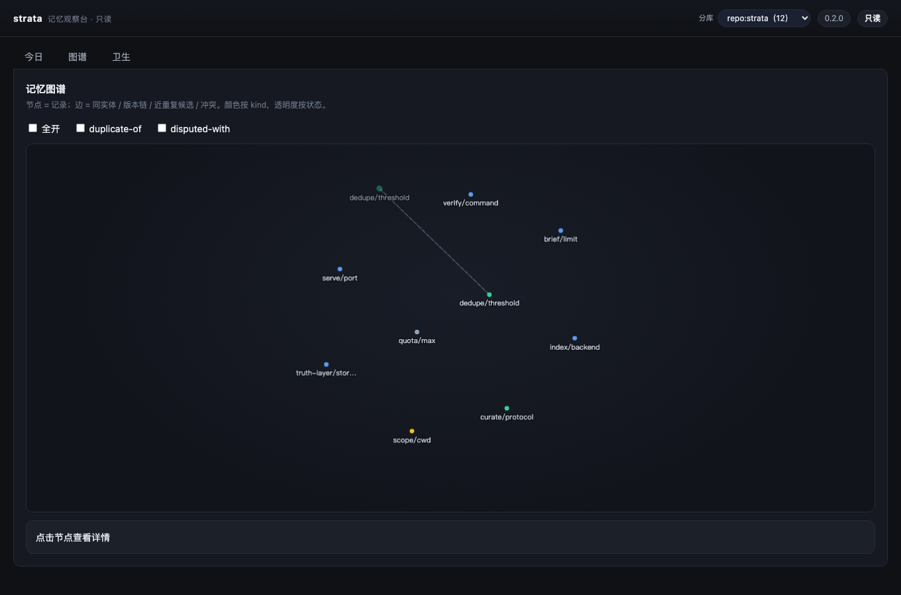
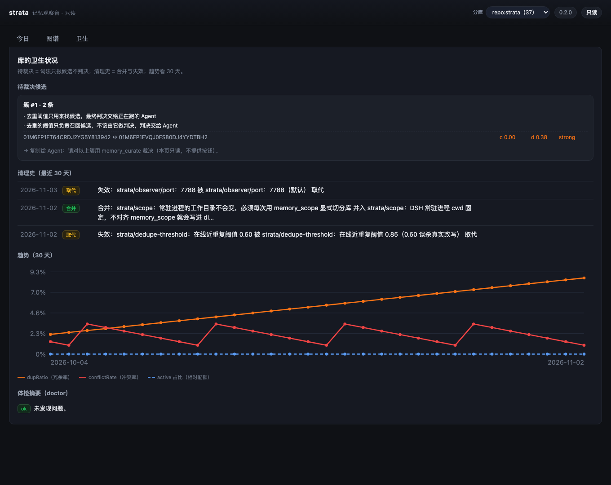

# strata

**跨会话、跨客户端的本地记忆层：把"记忆"当数据库治理，而不是当 prompt 攒。**

[](https://github.com/Old-Friends-Gathering/strata/actions/workflows/ci.yml)
[](https://github.com/Old-Friends-Gathering/strata/actions/workflows/quality.yml)
[](https://github.com/Old-Friends-Gathering/strata/actions/workflows/security.yml)
[](https://github.com/Old-Friends-Gathering/strata/actions/workflows/issue-link.yml)
[](LICENSE)

DSH / Codex CLI / Claude Code 三端共用一份本地记忆。重点不是"检索得准"，而是**治理得住**：
去重、冲突失效、过期不删只失效、投毒不进上下文、库自己会随使用收敛。

---

## 看一眼（只读观察台）

`memo serve` 起一个只绑 `127.0.0.1` 的只读页面，三页各有分工：

**今日变化** —— 这一天库里发生了什么（新增 / 被取代 / 删除 / 合并），每条带服务端生成的 label 和「为什么」。



**记忆图谱** —— 节点是记录，边是同实体时间链 / 版本链 / 近重复候选 / 冲突。默认只画前两类，可手动全开；节点可拖、可缩放，点一下看详情。



**卫生洞察** —— 待裁决的近重复候选（Agent 来裁决）、最近 30 天清理史、30 天冗余率/冲突率/配额占比趋势、`doctor` 体检。



```bash
node versions/v0.2/src/cli/memo.js serve        # 打开 http://127.0.0.1:7788
node versions/v0.2/src/cli/memo.js serve --help # 端口、分库、无 UI 模式
```

## 为什么叫 strata

记忆像地层（strata）一样**沉积**，而不是被反复改写覆盖：

| 地层 | 对应实现 | 规则 |
|---|---|---|
| 沉积层（真相层） | `$MEMO_HOME/items/<scope>.jsonl` | **只追加**，任何"改过去"都是追加一条新版本；永不删除物理行 |
| 派生层（索引/摘要） | 倒排索引、`brief` 渲染 | 随时可从真相层重建；坏了不丢数据 |
| 失效标记（不整合） | `superseded` / `tombstoned` + bi-temporal 时间戳 | 过时的事实**失效而非删除**，`asOf` 可回看任意时点 |
| 风化层（维护） | `nightly` 整合、配额淘汰、去重候选扫描 | 慢速、可离线、可重放；由 Agent 当裁判而不是纯算法 |

所以名字不是"又一个 memory 插件"，而是一个**可回溯、可重建、可收敛**的沉积结构。
产品名是 `strata`；技术标识为了向后兼容保持不变：CLI 仍是 `memo`、环境变量仍是 `MEMO_*`、
MCP 工具名仍是 `memory_*`、`serverName` 仍是 `memo`（改这些要同步三端客户端配置与历史分库目录，v0.2 再做带兼容期的重命名）。

## 它解决什么

| 常见做法的问题 | strata 的做法 |
|---|---|
| 记忆越攒越多，重复/矛盾条目一起进上下文 | 写入门控（hash 短路 → 同 slot 判等 → 近重复 noop）+ 冲突 slot 失效 |
| 换措辞的同一条事实被判成"冲突" | 在线只做**零误杀**去重；语义判断交给**正在运行的 Agent**（`dedupe_scan` → `curate_apply`），零 API 成本、可离线 |
| 只有"删掉"这一种清理手段 | 真相层不可变；过时=打 `validTo` 失效，删除=墓碑 + 延迟物理清理 |
| 记忆里被塞进指令型内容，悄悄影响后续会话 | 写入打标 + 读路径默认遮蔽（`[suspicious withheld]`）+ brief 逐行复检；10 种投毒变体实测 0 泄露 |
| 换个客户端就"失忆" | MCP 是唯一缝：DSH / Codex / Claude 同读写一份真相层；`memory_scope` 解决常驻进程 cwd 固定导致的分库错位 |

**刻意不做**：embedding 语义检索（v0.2 的 `EmbedderPort` 再说）、多机同步、加密存储、多用户隔离（scope 是分类不是权限）。

**v0.2 在做**：只读 Web UI「记忆观察台」——今日变化 / 记忆图谱 / 卫生洞察（设计见 [`docs/08`](docs/08-web-ui.md)，施工图见 [`docs/plans`](docs/plans/README.md)）。

## 文档（先读这个）

- **[`docs/00-principles-and-requirements.md`](docs/00-principles-and-requirements.md)** — C1–C6 硬需求与 8 条不可违背原则
- **[`docs/02-data-model-and-contract.md`](docs/02-data-model-and-contract.md)** — **实现契约唯一权威**（数据模型 7 条不变式 + 模块签名 + 29 条裁决）
- [`docs/01-architecture.md`](docs/01-architecture.md) — 分层、四类卫生路径、失败模式防线
- [`docs/03-iterability-and-versioning.md`](docs/03-iterability-and-versioning.md) — 六个 Port 扩展点、版本策略、v0.2 候选路线
- [`docs/04-eval-plan.md`](docs/04-eval-plan.md) — L1 单元 / L2 注入式 I1–I12 / L3 指标快照
- [`docs/05-process.md`](docs/05-process.md) — 角色与写权限、TDD 形状、issue→MR 强制流程
- **[`docs/07-quality-and-security.md`](docs/07-quality-and-security.md)** — 门禁指标与阈值（本仓库怎么保证不腐化）
- [`docs/06-usage.md`](docs/06-usage.md) — 三端落位、日常工具、维护例行、排障、Web UI 怎么看（§7）
- [`docs/08-web-ui.md`](docs/08-web-ui.md) — v0.2 只读 Web UI 设计契约（三页规格、接口表、门禁增项、§12 实现偏差）
- [`docs/09-sqlite-index.md`](docs/09-sqlite-index.md) — SQLite FTS5 索引（IndexPort 第二实现、`index.backend` 切换、fail-loud 约定）
- [`docs/10-curate-auto.md`](docs/10-curate-auto.md) — curate 裁决任务包（`memo curate prompt/apply --file/status`、校验 V1–V6、幂等）
- [`docs/plans/`](docs/plans/README.md) — 实施计划（任务分解、并行写盘范围、验收与回滚）
- [`docs/research/`](docs/research/README.md) — 调研证据（8 个开源系统横向对比、记忆卫生机制、为什么自建）

## 快速开始

```bash
NODE=${MEMO_NODE:-node}     # 任意 Node ≥ 22
cd versions/v0.2

$NODE --test 'tests/**/*.test.js'   # 单元 + 注入式回归（117 用例）
$NODE eval/run.js                   # I1–I12 评测，结果写 eval/results/
$NODE src/cli/memo.js --help        # CLI
$NODE src/mcp/server.js             # MCP server（stdio）
```

三端接入（DSH / Codex CLI / Claude Code）见 [`docs/06-usage.md`](docs/06-usage.md)，
模板在 [`versions/v0.2/configs/`](versions/v0.2/configs/)；一键验证脚本：

```bash
bash versions/v0.2/configs/verify-three-clients.sh   # dsh 写 → 另一进程 recall → 用召回值回答
```

## 门禁（每次 push / PR 自动跑）

| 门禁 | 内容 | 阈值 |
|---|---|---|
| [`ci`](.github/workflows/ci.yml) | 单元 + 注入式回归（Node 22/24）、I1–I12 评测、覆盖率 | 0 失败；lines ≥ 85% / branches ≥ 70% / functions ≥ 90% |
| [`quality`](.github/workflows/quality.yml) | 零依赖、源码规模、测试清单、评测对齐、契约覆盖、文档链接、版本自包含、编码卫生 | 8/8 |
| [`security`](.github/workflows/security.yml) | 个人路径、凭据、内部域名/内网 IP、配置可移植、`.gitignore`、许可证、大文件、历史面 + CodeQL | 8/8 |
| [`issue-link`](.github/workflows/issue-link.yml) | **MR 必须关联一条 open 的 issue** | 必须 |

**`main` 是受保护分支，且对管理员同样生效**：直推与 force push 会被拒绝
（`GH006 ... 7 of 7 required status checks are expected`），任何改动都必须走
`issue → 分支 → PR → 七项检查全绿 → squash 合并`。实测证据见
[`docs/07`](docs/07-quality-and-security.md#八线上状态与验收证据2026-11-02-实测)。

本地与 CI 跑同一份脚本（提交前先自己跑一遍，省一轮 CI）：

```bash
node tools/quality-check.mjs     # 8 项
node tools/security-check.mjs    # 8 项
node tools/coverage-gate.mjs     # 3 项
```

指标定义、阈值理由、谁能改阈值 → [`docs/07-quality-and-security.md`](docs/07-quality-and-security.md)；
提交流程 → [`CONTRIBUTING.md`](CONTRIBUTING.md)。

## 迭代纪律（四条，违反即回退）

1. **文档先行**：接口/数据模型/工具语义变更先改 `docs/02` 并写 ADR 段，再改代码。
2. **TDD**：新行为先加失败测试；注入式回归是发布门禁，不允许改断言来变绿。
3. **可替换**：能力都在 Ports 后面（Storage / Index / Judge / Renderer / Clock），新增实现=新增适配器，不改 core。
4. **真相层不可变**：`items/*.jsonl` 只追加；"改过去"= 追加新版本；索引随时可重建。

## 目录

```
strata/
├── docs/                    # 跨版本文档（00–07 + research/ 证据）
├── tools/                   # 门禁脚本（quality / security / coverage，零依赖）
├── .github/                 # 四个 workflow + issue/PR 模板 + CODEOWNERS
├── versions/
│   ├── CURRENT              # 当前版本指针（v0.2）——门禁与 CI 都读它
│   ├── v0.1/                # 🔒 冻结（0.1.2 快照，见 FROZEN.md）
│   └── v0.2/                # ✅ 当前开发线：src/ tests/ eval/ configs/ ui/ docs/ CHANGELOG
└── README.md
```

## 版本

| 版本 | 主题 | 状态 |
|---|---|---|
| v0.1.x（`versions/v0.1`） | 核心记忆层（append-only 真相层 + 派生索引 + brief）、四条卫生路径、MCP/CLI、注入式评测 I1–I12、门禁体系 | 🔒 冻结在 0.1.2 |
| **v0.2.0**（`versions/v0.2`） | 只读 Web 观察台（今日/图谱/卫生）+ SQLite FTS5 后端 + curate 裁决任务包 + 多分库浏览 + 图谱跟随分库 | ✅ 当前 |
| v0.2.x 候选 | JudgePort 注入点、kind 注册表数据化、compact/物理清理、EmbeddingIndex、service 拆分 | 未开始 |

版本目录规则：**大版本换目录（v0.1 → v0.2），小版本在同一目录内递增（0.2.0 → 0.2.1）**；
老目录冻结并保留 `FROZEN.md`。指针在 `versions/CURRENT`。

## 许可

[MIT](LICENSE) © 2026 Old Friends Gathering
