> doc-kind: manual
> doc-version: 1.0

<div align="center">

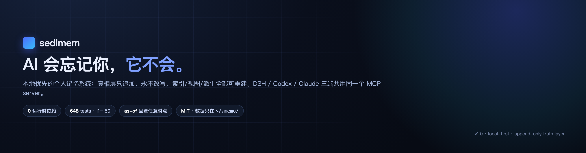

**中文** · [English](README.en.md)

[](https://github.com/Old-Friends-Gathering/sedimem/actions/workflows/ci.yml)
[](https://github.com/Old-Friends-Gathering/sedimem/actions/workflows/quality.yml)
[](https://github.com/Old-Friends-Gathering/sedimem/actions/workflows/security.yml)
[](https://github.com/Old-Friends-Gathering/sedimem/actions/workflows/pages-verify.yml)
[](LICENSE)
[](package.json)

**AI 会忘记你，它不会。**

- 🔒 **真相层不可变**：`~/.memo/items/<scope>.jsonl` 只追加、永不原地改，改过去 = 追加新版本，可 `as-of` 回查任意时点
- 🔌 **三端共用一个记忆**：DSH / Codex CLI / Claude Code 连同一个 stdio MCP server、同一个分库
- 🧱 **零依赖离线**：12 个模块，0 运行时依赖（Node ≥ 22，内置 `node:sqlite` FTS5），不开 LLM 也完整可用

</div>

## 它是什么

sedimem 是本地优先的个人 AI 记忆系统。所有数据只存在你的本机 `~/.memo/`，真相层只追加不可改写，索引、视图、LLM 派生层全部可以删光重建。记忆像地层一样沉积，而不是被反复覆盖。

30 秒跑起来：

```bash
git clone https://github.com/Old-Friends-Gathering/sedimem && cd sedimem
NODE=$(command -v node); V=versions/$(cat versions/CURRENT)
$NODE $V/src/cli/memo.js write --kind fact --title "CI 要求 Node 22+" --text "部署流水线要求 Node 22 及以上" --agent cli
$NODE $V/src/cli/memo.js search "node 版本"
$NODE $V/src/cli/memo.js serve --port 7788   # 记忆中心 http://127.0.0.1:7788
```

> [!TIP]
> 不装也能试：`memo doctor` / `memo stats` 均为只读命令；记忆中心默认只读，加 `--write` 才可编辑（token + If-Match 防误写）。

## 为什么不用现成的

| 项目 | 强项 | sedimem 不同在哪 |
|---|---|---|
| mem0 | 自动提取、云端服务 | 它靠 LLM 抽取与改写；sedimem 真相层不可变，提取只进旁路派生层 |
| claude-mem | Claude 生态自动记忆 | 只服务 Claude；sedimem 三端共用同一 stdio MCP server |
| dsh-engram | Windows 支持、图谱面板 | 图谱面板思路相近；sedimem 另有 as-of 回查与投毒可审计 |
| supermemory | 云同步、跨设备 | 云为主；sedimem 刻意本地优先，删 `~/.memo/` 即彻底清除 |
| 自建 Markdown | 简单可控 | 无索引、无去重、无冲突裁决；sedimem 有 BM25+语义检索与卫生门禁 |

> [!NOTE]
> sedimem 没有云同步与多人权限——这是刻意不做，不是没做。

## 架构

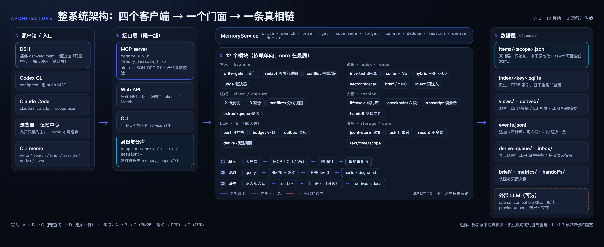

- **三层单向**：客户端 → 接口层（CLI / MCP / Web）→ MemoryService → 12 模块（core / storage / index / hygiene / render / views / session / capture / llm / mcp / web / cli）→ 数据层，依赖只朝下。
- **写入四道门**：schema 校验 → 脱敏（密钥/内网域名/私有路径 → `[REDACTED:x]`，落盘前）→ 去重（contentHash / 实体键 / 汉字二元组 Dice 0.15 召回、0.85 判重）→ 冲突（同 slot 异值 → superseded 或 disputed，可交 Agent 裁决）。
- **派生旁路**：LLM 总结走 outbox → sidecar（`derived/<scopeKey>.jsonl`），失败只降级，真相层字节不变。

**两条主链路的细节**：

| 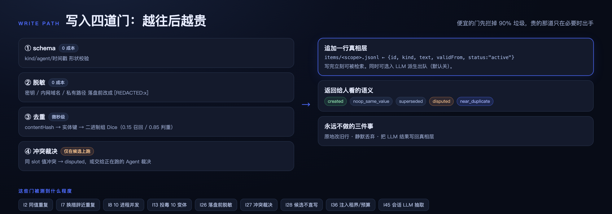 | 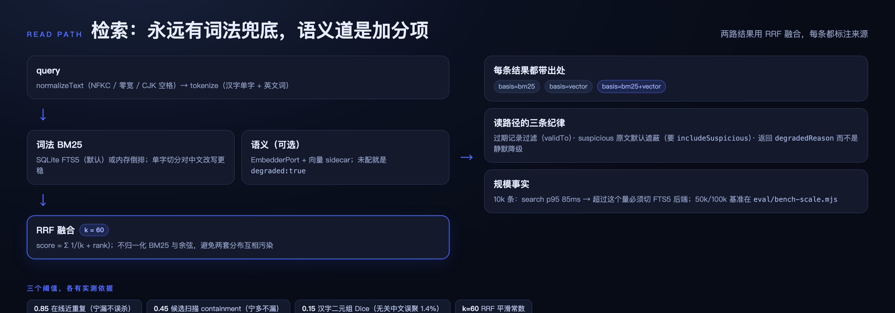 |
|---|---|
| 写入四道门：越往后越贵，便宜的先拦掉大部分噪声 | 读取双路融合：词法永远兜底，语义道不可用时显式 `degraded` |

> [!IMPORTANT]
> 真相层（`~/.memo/items/`）是唯一权威：只追加、永不原地改；索引/视图/派生可删光重建，重建不丢事实。

## 功能

| 能力 | 说明 | 命令 |
|---|---|---|
| 写入 | 四道门依次过，过了才追加 | `memo write` |
| 检索 | BM25（FTS5）± 语义道 → RRF k=60，结果带 basis，语义挂了显式 degraded | `memo search` |
| 简报 | 当前 scope 概览 | `memo brief` |
| 治理 | 去重扫描、冲突裁决、新旧取代、墓碑删除 | `memo dedupe` / `curate` / `supersede` / `forget` |
| LLM 派生 | 标题/摘要/标签旁路生成，默认关 | `memo derive` / `llm` |
| 会话临时库 | 探索先进临时库，close 白名单晋升 | `memo session` |
| 记忆中心 | 九页 Web UI，默认只读 | `memo serve --port 7788` |
| 体检 | 环境/分库/索引健康检查 | `memo doctor` / `stats` |
| 迁移重建 | 版本目录迁移、索引删光重建 | `memo migrate` / `reindex` / `compact` |

## 记忆中心

`memo serve --port 7788`，九页：今日 / 图谱 / 搜索 / 卫生 / 编辑 / 导入 / 会话 / 交接 / 设置。

| 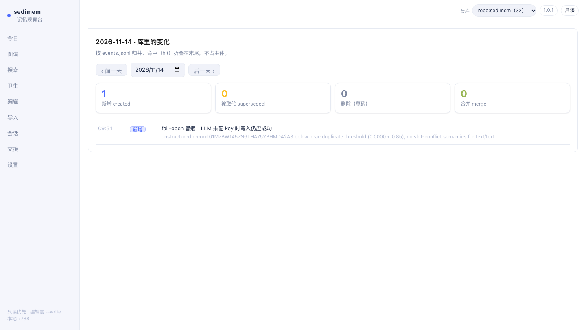 | 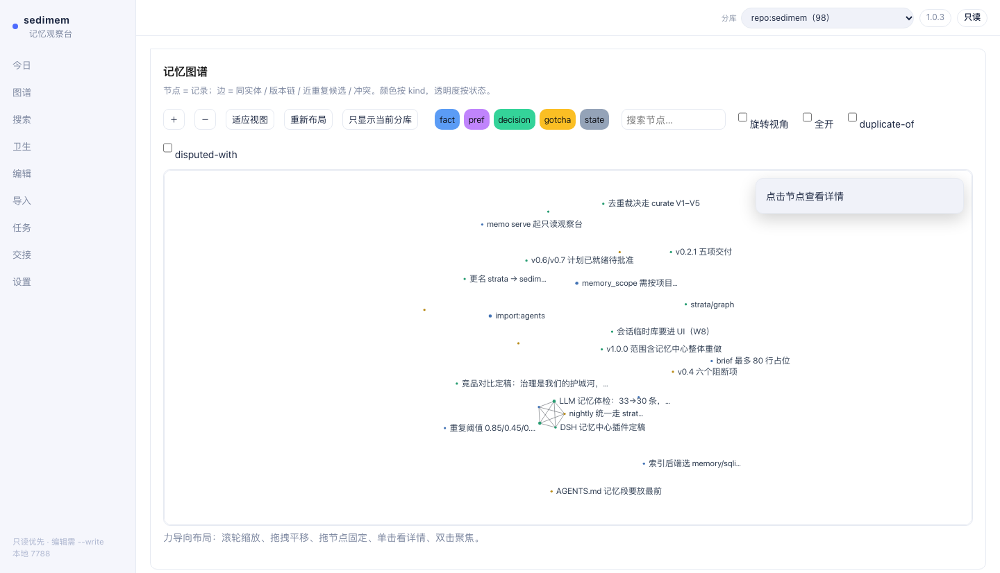 |
|---|---|
| 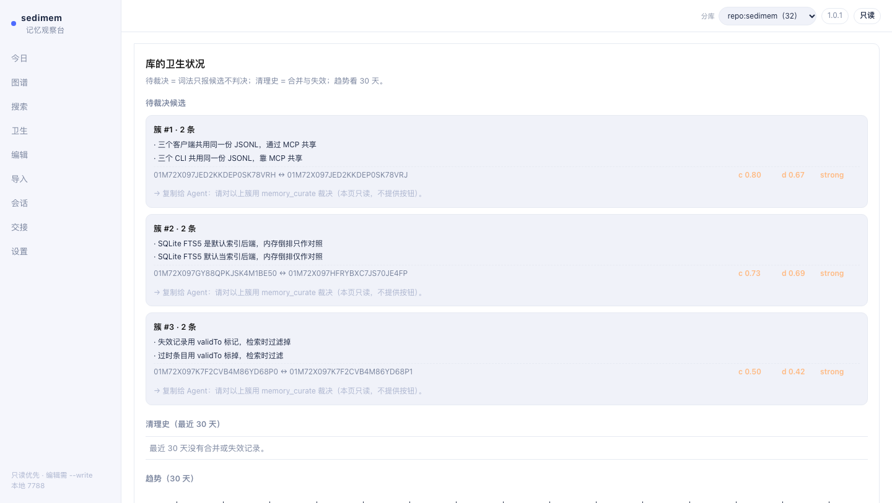 | 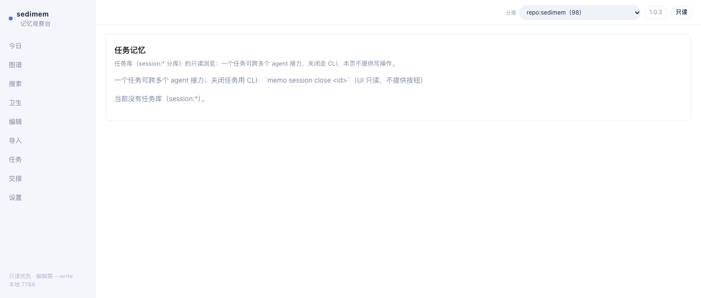 |

| 页 | 干什么 | 页 | 干什么 |
|---|---|---|---|
| 今日 | 当天变化流 | 编辑 | `--write` 才可改 |
| 图谱 | 力导向全貌 + kind 筛选 | 导入 | 批量结构化 |
| 搜索 | 带依据（basis）检索 | 会话 | 临时库状态 |
| 卫生 | 待裁决簇 + 30 天趋势 | 交接 | 六段交接文档 |
| 设置 | 分库 / 配色 / 策略只读 | | |

## LLM 总结层（可选）

默认 `provider=none`，整层不存在；开启后派生只写 sidecar，真相层字节不变。

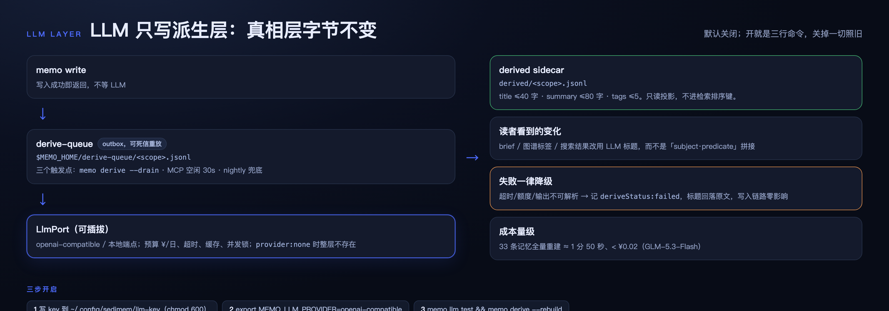

```bash
mkdir -p ~/.config/sedimem && printf '%s\n' '<key>' > ~/.config/sedimem/llm-key && chmod 600 ~/.config/sedimem/llm-key
export MEMO_LLM_PROVIDER=openai-compatible MEMO_LLM_BASE_URL=https://open.bigmodel.cn/api/paas/v4 MEMO_LLM_MODEL=glm-5.3-flash
memo llm status && memo llm test && memo derive --rebuild
```

成本实测（GLM-5.3-Flash）：33 条全量重建 ≈1m50s、**<¥0.02**；派生失败只降级，不影响写入与检索。

> [!NOTE]
> 开 LLM 后，标题/摘要/标签的生成请求会发往你配置的 provider；原始记忆文本仍只在本机，真相层不参与请求。

## 会话临时库

探索性工作先进 `session:*` 临时库（禁写 fact）；close 只把 decision/gotcha 晋升主库（带 `from-session:<id>` 标签），其余随库废弃，并生成六段交接文档 `docs/handoffs/<id>.md`。

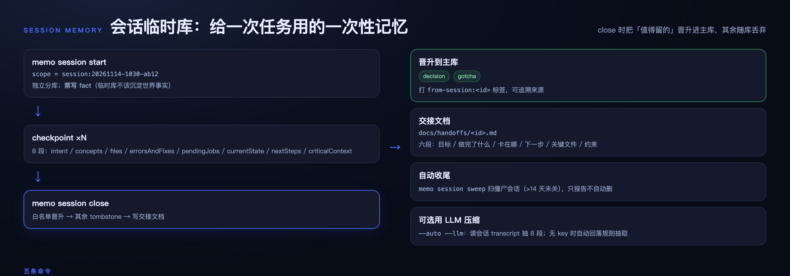

```bash
memo session start --title "调试锁竞争"
memo session checkpoint --intent "查锁竞争根因"
memo session status
memo session close      # 晋升 + 生成交接文档
memo session sweep      # 扫 14 天僵尸库
```

<details>
<summary><strong>接入三个客户端</strong></summary>

三端各配一条 stdio MCP，指向同一个 `server.js` 和同一个 `MEMO_HOME`。常驻进程（DSH）记得先 `memory_scope` 对齐分库。

```yaml
# DSH：~/.dsh/profiles/<profile>/cordis.patch.yml
- insert:
    - id: memory-sedimem
      name: '@deepseek-ai/dsh-mcp-client'
      config:
        serverName: memo
        transport: stdio
        command: node
        args: ['/ABS/PATH/versions/v1.0/src/mcp/server.js']
        env: { MEMO_HOME: '$HOME/.memo' }
```

```toml
# Codex CLI：~/.codex/config.toml
[mcp_servers.memo]
command = "node"
args = ["/ABS/PATH/versions/v1.0/src/mcp/server.js"]
enabled = true
[mcp_servers.memo.env]
MEMO_HOME = "$HOME/.memo"
```

```bash
# Claude Code
claude mcp add --scope user memo -e MEMO_HOME=$HOME/.memo -- \
  node /ABS/PATH/versions/v1.0/src/mcp/server.js
```

自检：`bash versions/v1.0/configs/verify-three-clients.sh`（期望 `PASS`）。

工具面：10 个 `memory_*` + 5 个 `memory_session_*`，三端完全一致。

</details>

<details>
<summary><strong>CLI 与 MCP 速查</strong></summary>

| 命令 | 作用 |
|---|---|
| `write` / `search` / `brief` / `get` | 写入 / 检索 / 简报 / 取单条 |
| `supersede` / `forget` | 新值取代旧记录 / 删除（默认写墓碑） |
| `curate` / `dedupe` / `compact` | 裁决去重簇 / 扫描候选 / 压缩 |
| `session` / `derive` / `llm` | 会话临时库 / 派生重建 / LLM 配置 |
| `serve` / `doctor` / `stats` | 记忆中心 / 体检 / 统计 |
| `reindex` / `migrate` / `view` | 重建索引 / 版本迁移 / 视图 |

| MCP 工具 | 作用 |
|---|---|
| `memory_write` / `memory_search` / `memory_get` | 写 / 检索 / 取单条 |
| `memory_brief` / `memory_stats` | 简报 / 统计 |
| `memory_supersede` / `memory_forget` | 取代 / 删除 |
| `memory_dedupe_scan` / `memory_curate` | 去重扫描 / 裁决 |
| `memory_scope` | 查看或切换分库 |
| `memory_session_*`（5 个） | 临时库 start / checkpoint / status / close / sweep |

</details>

## 门禁

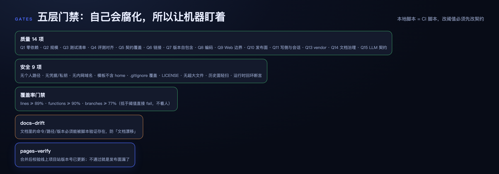

本地脚本 = CI 脚本：质量 14 项 + 安全 9 项 + 覆盖率（lines ≥ 89 / functions ≥ 90 / branches ≥ 77）+ docs-drift + pages-verify，另含 648 tests 与 eval I1–I50。

```bash
node tools/quality-check.mjs && node tools/security-check.mjs && node tools/coverage-gate.mjs
```

## 文档地图

| 文档 | 解决什么 |
|---|---|
| [docs/00](docs/00-principles-and-requirements.md) | 原则与硬需求 |
| [docs/01](docs/01-architecture.md) | 分层与失败模式 |
| [docs/02](docs/02-data-model-and-contract.md) | **数据契约（唯一权威）** |
| [docs/06](docs/06-usage.md) | 三端落位与日常操作 |
| [docs/07](docs/07-quality-and-security.md) | 门禁指标与阈值 |
| [docs/08](docs/08-web-ui.md) | 记忆中心九页规格 |
| [docs/research](docs/research/README.md) | 为什么自建（横评 8 系统） |

## 版本

| 版本 | 主题 | 状态 |
|---|---|---|
| **v1.0.2** | 三处真 fix（思考链/重建/懒加载）+ 文档改图为主 | ✅ 当前 |
| v1.0.1 | 图谱可用性 + 配色对齐 DSH | ✅ 已交付 |
| v1.0.0 | 12 模块重构 + LLM 总结层 + 九页重做 | ✅ 已交付 |
| 更早（v0.1–v0.6） | 核心层、语义道、pages-verify 等 | 🔒 冻结 |

`X.Y` 换目录、`X.Y.Z` 同目录补丁；指针在 `versions/CURRENT`（当前 v1.0）。

## FAQ

**要 LLM 吗？** 不要。`provider=none` 默认且完整可用，门禁/检索/brief/图谱全部零 LLM 成本。

**开 LLM 花多少钱？** 可忽略：33 条全量重建 <¥0.02、约 2 分钟；增量 drain 更便宜。

**数据在哪？** 全在 `~/.memo/`，删目录即彻底清除，无任何云组件；不开 LLM 时数据不出本机。

**三端怎么共库？** 各配一条 stdio MCP，指向同一 `server.js`、同一 `MEMO_HOME`；常驻进程先 `memory_scope` 对齐分库。

**能多人用吗？** scope 是分类不是权限边界；多人协作需要独立部署与鉴权，这是刻意不做的。

**和 mem0 / claude-mem 区别？** 它们擅长自动提取；sedimem 重心在治理——三端共用 + as-of 回查 + 真相层不可变 + 投毒可审计。

## Contributing

欢迎 Issue 与 PR。改文档请同步改契约（`docs/02`），门禁会拦 docs-drift。

**In scope**：bug 修复、检索与卫生算法改进、新 CLI/Web 能力（先开 Issue 对齐）。

**Out of scope**：云同步、多人权限、遥测上报。

## Security

所有数据只在本机 `~/.memo/`，无云组件、无遥测。脱敏发生在落盘之前：密钥、内网域名、私有路径写为 `[REDACTED:x]`。Web 界面默认只读，`--write` 模式需 token + If-Match。发现安全问题请先开 security advisory 而非公开 Issue。

## License

[MIT](LICENSE) © 2026 Old Friends Gathering
