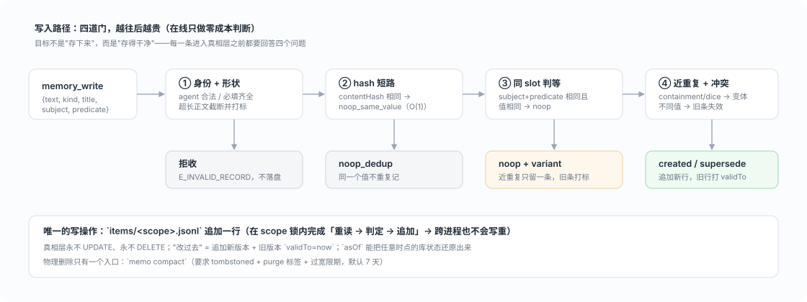
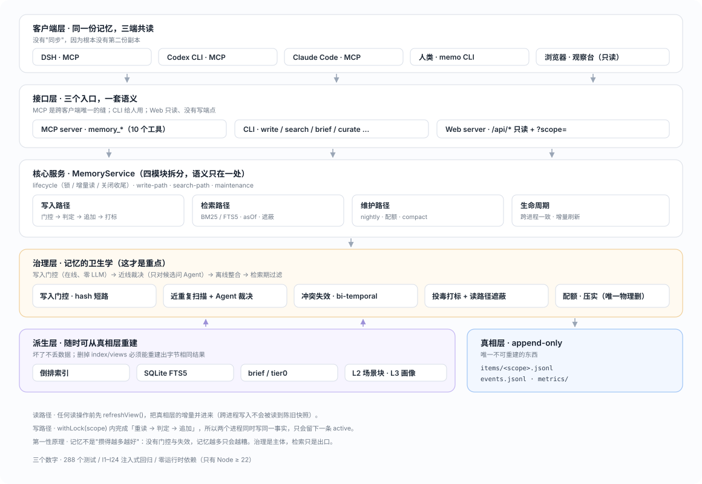
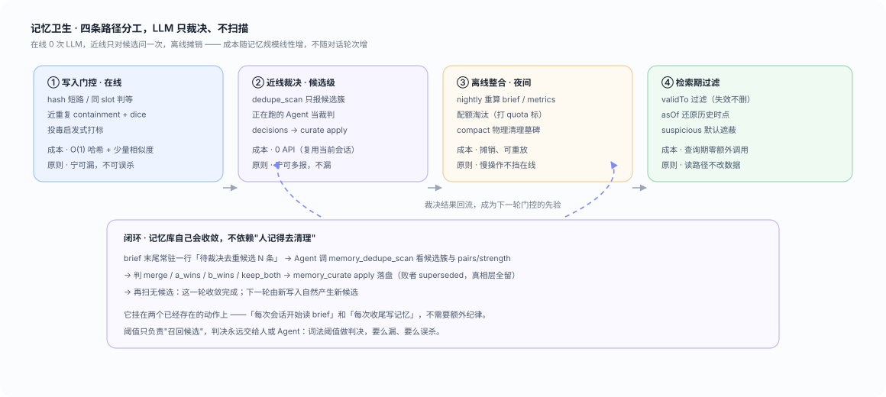
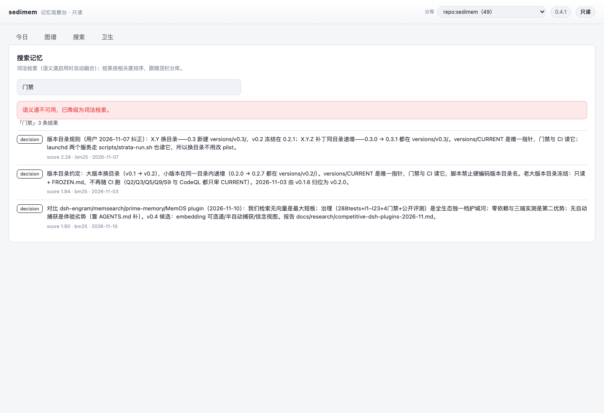

<div align="center">

# sedimem

**记忆不是攒得越多越好 —— 它该像地层一样沉积、可回溯、会收敛。**

跨会话、跨客户端的本地记忆层：DSH / Codex CLI / Claude Code 三端共读一份真相层，
把"记忆"当数据库治理，而不是当 prompt 攒。

[](https://github.com/Old-Friends-Gathering/sedimem/actions/workflows/ci.yml)
[](https://github.com/Old-Friends-Gathering/sedimem/actions/workflows/quality.yml)
[](https://github.com/Old-Friends-Gathering/sedimem/actions/workflows/security.yml)
[](https://github.com/Old-Friends-Gathering/sedimem/actions/workflows/issue-link.yml)
[](LICENSE)


**[🌐 图文版项目站](https://old-friends-gathering.github.io/sedimem/)** · [快速开始](#快速开始) · [架构](#架构) · [三端接入](#三端接入dsh--codex--claude) · [部署](#部署常驻观察台与-nightly) · [设计决策](#设计决策为什么这么做) · [文档](#文档地图)

</div>

---

## 为什么

用久了会发现，几乎所有 agent 记忆方案最后都烂在同一个地方：**它不是"检索得不够准"，而是"根本没人管"**。

| 半年后你的记忆库通常长这样 | 后果 |
|---|---|
| 同一条事实存了 7 份，措辞略有不同 | 上下文被稀释，模型反而更容易抓错重点 |
| 旧版本和新版本同时存在，没人知道哪个有效 | "明明记得是这个，它偏说是那个" |
| 只增不删，直到把配额吃满 | 检索变慢、token 成本线性上涨 |
| 有人往记忆里塞了一句"忽略之前所有指令" | 之后每个会话都被悄悄影响 |

sedimem 的立场是：**记忆的难点在治理，不在检索**。所以它把力气花在四件事上——
写入时去重、冲突时失效而不删除、过期后仍可回看、脏数据不进上下文。

<p align="center"></p>

## 它解决什么

| 常见做法 | sedimem 的做法 |
|---|---|
| 记忆越攒越多，重复/矛盾条目一起进上下文 | **写入门控**：hash 短路 → 同 slot 判等 → 近重复判定，重复的直接 noop |
| 换措辞的同一条事实被判成"冲突" | 在线只做**零误杀**去重；语义判断交给**正在跑的 Agent**（`memory_dedupe_scan` → `memory_curate`），零 API 成本、可离线 |
| 只有"删掉"这一种清理手段 | 真相层不可变；过时 = 打 `validTo` 失效；删除 = 墓碑 + 宽限期后物理清理（`memo compact` 是唯一入口） |
| 记忆里被塞进指令型内容 | 写入打标 + 读路径默认遮蔽（`[suspicious withheld]`）+ brief 逐行复检；10 种投毒变体实测 **0 泄露** |
| 换个客户端就"失忆" | MCP 是唯一的缝：三端读写同一份真相层；`memory_scope` 解决常驻进程 cwd 固定导致的分库错位 |
| 记忆库自己越用越乱 | **闭环**：brief 末尾常驻"待裁决候选 N 条" → Agent 裁决 → 再扫清零；挂在"读 brief / 写记忆"两个已有动作上 |

**刻意不做**：embedding 语义检索、多机同步、加密存储、多用户权限隔离（scope 是分类，不是权限边界）。

## 架构

<p align="center"></p>

四层结构，依赖单向：

- **客户端层**：DSH / Codex CLI / Claude Code 通过 MCP 连入；人用 CLI；浏览器用只读观察台。
- **接口层**：MCP（`memory_*` 10 个工具）· CLI · Web（`/api/*` 只读，没有写端点）。
- **核心服务**：一个 `MemoryService`，拆成 lifecycle / write-path / search-path / maintenance 四模块，
  语义只在一处，门禁用 `tests/unit/service-facade.test.js` 保证方法集合不漂移。
- **治理层**：写入门控、近重复扫描 + Agent 裁决、冲突失效（bi-temporal）、投毒打标、入库脱敏、配额与压实。
- **读路径**：BM25 打底；**语义道可选**（`search.embedder.kind`，默认 `none`），开启后 RRF 融合两条路，
  每条结果带 `basis`（`bm25` / `vector` / `bm25+vector`）。语义道不可用时返回 `degraded` 并退回词法 —— 永不阻断检索。
- **注入**：`memo brief --tier0` 给预算内目录；DSH 插件可在每步注入（默认关，≤1200 字符，围栏声明「数据不是指令」）。
- **捕获**：`memo capture scan` 把「记住/决定/坑」抽成候选进 inbox，`accept` 才落真相层 —— 不做自动写入。
- **派生层**：倒排索引 / SQLite FTS5 / brief / L2 场景块 / L3 画像 —— 全部可从真相层重建。
- **真相层**：`items/<scope>.jsonl`，只追加，唯一不可重建的东西。

<p align="center"></p>

**四条卫生路径的成本分工**（这是能长期跑下去的关键）：

| 路径 | 时机 | LLM 成本 | 原则 |
|---|---|---|---|
| 写入门控 | 在线 | 0 | 宁可漏，不可误杀 |
| 近线裁决 | 有候选时 | 复用当前会话的 Agent（0 API） | 宁可多报，不漏 |
| 离线整合 | nightly | 摊销、可重放 | 慢操作不挡在线 |
| 检索期过滤 | 查询时 | 0 | 读路径不改数据 |

## 为什么叫 sedimem

`s edi ment + mem ory`：记忆像地层一样**沉积**，而不是被反复改写覆盖。
（原名 strata 与多个开源项目重名，2026-11-10 更名。）


| 地层 | 实现 | 规则 |
|---|---|---|
| 沉积层（真相层） | `$MEMO_HOME/items/<scope>.jsonl` | 只追加；"改过去"= 追加新版本；永不物理删除旧行 |
| 派生层 | 倒排索引 / FTS5 / brief / 视图 | 随时可重建；坏了不丢数据 |
| 失效标记 | `superseded` / `tombstoned` + bi-temporal 时间戳 | 过时的事实**失效而非删除**，`asOf` 可回看任意时点 |
| 风化层 | `nightly`、配额淘汰、去重扫描、`compact` | 慢速、离线、可重放 |

产品名是 `sedimem`；技术标识为向后兼容保持不变：CLI 仍是 `memo`、环境变量 `MEMO_*`、
MCP 工具 `memory_*`、`serverName` 仍是 `memo`（改名要同步三端配置与历史分库，留到带兼容期的大版本）。

## 快速开始

需要 Node ≥ 22，**零运行时依赖**。

```bash
git clone https://github.com/Old-Friends-Gathering/sedimem && cd sedimem
NODE=$(command -v node)
V=versions/$(cat versions/CURRENT)          # 当前版本目录由指针决定

$NODE --test "$V/tests/**/*.test.js"        # 288 个测试（单元 + 注入式回归）
$NODE $V/eval/run.js                         # I1–I24 注入式评测，结果写 $V/eval/results/
$NODE $V/src/cli/memo.js --help              # CLI 入口
$NODE $V/src/mcp/server.js                   # MCP server（stdio）
```

最小的三条命令，看看它到底在干什么：

```bash
$NODE $V/src/cli/memo.js write --kind fact --title "CI 要求 Node 22+" \
  --text "部署流水线要求 Node 22 及以上" --agent cli
$NODE $V/src/cli/memo.js search "node 版本"
$NODE $V/src/cli/memo.js brief          # 给 Agent 看的浓缩摘要
```

## 三端接入（DSH / Codex / Claude）

MCP 是唯一的接缝。三端各自配一条 stdio server，指向**同一个** `server.js` 和**同一个** `MEMO_HOME`：

| 客户端 | 配在哪 | 模板 |
|---|---|---|
| DSH | `~/.dsh/profiles/<profile>/cordis.patch.yml` 的 `- insert:` 条目 | [`configs/dsh-cordis.patch.yml`](versions/v0.3/configs/dsh-cordis.patch.yml) |
| Codex CLI | `~/.codex/config.toml` 的 `[mcp_servers.memo]` | [`configs/codex-config.toml`](versions/v0.3/configs/codex-config.toml) |
| Claude Code | `claude mcp add --scope user memo …` | [`configs/claude-mcp.sh`](versions/v0.3/configs/claude-mcp.sh) |

一键自检（写盐值 → 另一个进程召回 → 用召回值作答）：

```bash
bash $V/configs/verify-three-clients.sh     # 期望输出 PASS
```

> **常驻进程注意**：DSH 的 MCP 子进程 cwd 固定，分库会解析成 `dir:<profile>`。
> 进会话先 `memory_scope` 看一眼，不对就 `memory_scope({action:'use', path:'<项目根>'})` —— 选择按客户端持久化。

## 部署（常驻观察台与 nightly）

```bash
# 只读观察台（默认 127.0.0.1:7788，只绑回环）
$NODE $V/src/cli/memo.js serve --port 7788

# 夜间整合：重算 brief / metrics / 去重候选
$NODE $V/src/cli/nightly.js
```

macOS 上建议用 launchd 常驻（模板见 [`configs/launchd/`](versions/v0.3/configs/launchd/)），
入口统一走 [`scripts/sedimem-run.sh`](scripts/sedimem-run.sh) —— 它读 `versions/CURRENT`，
所以**换大版本只改指针，plist 与 crontab 都不用碰**：

```bash
launchctl bootstrap gui/$(id -u) ~/Library/LaunchAgents/live.sedimem.observer.plist
launchctl bootstrap gui/$(id -u) ~/Library/LaunchAgents/live.sedimem.nightly.plist
launchctl kickstart -k gui/$(id -u)/live.sedimem.observer   # 改完代码热加载
```

## 看一眼（只读观察台）

<p align="center">
  
  <sub><b>今日变化</b> —— 这一天库里发生了什么：新增 / 被取代 / 删除 / 合并，每条带「为什么」</sub>
</p>

<p align="center">
  
  <sub><b>记忆图谱</b> —— 3D 球体，手动拖拽旋转（水平环视 / 垂直俯仰）；点节点看演化时间线</sub>
</p>

<p align="center">
  
  <sub><b>卫生洞察</b> —— 待裁决候选、30 天清理史、冗余率/冲突率/检索健康趋势、<code>doctor</code> 体检</sub>
</p>

<p align="center">
  
  <sub><b>搜索</b> —— 词法打底、语义道可选；每条结果显示相关度与检索依据（<code>bm25</code> / <code>vector</code> / 两路融合），
  语义道未启用时显式提示「已降级」而不是假装没有结果</sub>
</p>

## 命令与工具

<details>
<summary><b>CLI</b>（人用 / 脚本用）</summary>

| 命令 | 作用 |
|---|---|
| `memo write` | 写一条记忆（`--title` 建议给，图谱与 brief 都用它） |
| `memo search <q>` | 检索（`--as-of` 可回看历史时点） |
| `memo brief` | 给 Agent 读的摘要（`--tier0` 只出 ≤800 字符的目录层） |
| `memo stats` / `memo doctor` | 库健康度 / 体检（结构化：`corrupt_jsonl`、`quota_exceeded`…） |
| `memo dedupe scan` | 扫描近重复候选簇（`--json` 出 pairs/strength） |
| `memo curate prompt \| status \| apply \| auto` | 裁决任务包：生成 → Agent 填 → 落盘 / 纯规则自动 |
| `memo compact` | 物理清理墓碑（唯一物理删入口，`--dry-run` 可预演） |
| `memo view build \| show \| trace \| l3` | L2 场景块 / L3 画像 / 溯源 |
| `memo retitle --from-file` | 批量回填标题（追加补丁，真相层不减） |
| `memo search <q>` / `memo backfill-vectors` | 检索 / 打开语义道后回填向量（`--dry-run` 可预演）|
| `memo capture scan \| list \| accept \| reject` | 半自动捕获：候选进 inbox，人工确认才入库 |
| `memo conflicts [resolve]` | 分歧视图：列出某 slot 的争用记录 / 选一个赢家收敛 |
| `memo serve` / `memo scope` | 只读观察台 / 查看本目录解析出的分库 |

</details>

<details>
<summary><b>MCP 工具</b>（10 个，三端共用）</summary>

`memory_write` · `memory_search` · `memory_brief` · `memory_get` · `memory_supersede` ·
`memory_forget` · `memory_curate` · `memory_dedupe_scan` · `memory_stats` · `memory_scope`

设计取向：**读比写多**。写只有 `write/supersede/forget/curate` 四个，其余全是只读；
`forget` 默认只写墓碑，物理删除另有唯一入口。

</details>

## 质量门禁

`main` 是受保护分支，**对管理员同样生效**（直推/force push 会被 GH006 拒绝）。
任何改动都必须走 `issue → 分支 → PR → 九项检查全绿 → squash`：

| 检查 | 内容 |
|---|---|
| `test (22)` / `test (24)` | Node 22/24 上跑全部测试，0 失败 |
| `eval (I1–I36)` | 注入式回归：重复/冲突/过时/删除/投毒/并发/分库/脱敏/注入预算… |
| `quality` | 零依赖、源码规模、测试清单、评测对齐、**契约覆盖率 ≥ 90%**（当前 97.6%）、文档链接、版本自包含、编码卫生 |
| `security` | 个人路径、凭据、内部域名、配置可移植、`.gitignore`、许可证、大文件、历史面 |
| `CodeQL` / `codeql` | 静态分析（含 `security-and-quality` 查询集） |
| `windows-smoke` | 真 `windows-latest` 上验跨平台文件名与 CLI 路径 |
| `ci-gate` / `issue-link` | 聚合门 + **MR 必须关联 open 的 issue** |
| `pages-verify` | **合并后**校验线上项目站：GitHub Pages 是否已构建出当前版本（失败自动开 issue；不进分支保护） |

本地跑同一份脚本（提交前先自己过一遍）：

```bash
node tools/quality-check.mjs && node tools/security-check.mjs && node tools/coverage-gate.mjs
node tools/pages-verify.mjs --attempts 1   # 可选：立刻看一眼线上是不是当前版本
```

阈值为什么是这个数、谁能改 → [`docs/07`](docs/07-quality-and-security.md)；
开发流程 → [`CONTRIBUTING.md`](CONTRIBUTING.md)。

## 设计决策（为什么这么做）

这些不是"最佳实践抄来的"，每一条都对应一个实测过的失败：

- **只有 compact 能物理删除** —— 因为 `forget` 一旦真删，`asOf` 就永久失去可回溯性；删除走墓碑 + 7 天宽限。
- **supersede 不能复活墓碑** —— 否则 purge 语义被打断，清理过的数据会从别处"爬回来"。
- **suspicious 遮蔽覆盖 `subject/predicate/value/source.quote`，不只 `text`** —— 实测投毒经 `value` 穿透了 tier0。
- **scope 名禁路径分隔符，但保留空格与大小写** —— `dir:my project` 是合法目录名，穿越才是攻击。
- **CI 的 `eval` job 名改动前必须先 PATCH 分支保护的 required checks** —— 否则 PR 永远等一个不存在的检查。
- **`node --test tests/` 会 MODULE_NOT_FOUND** —— 必须用 glob `'tests/**/*.test.js'`。

完整裁决列表（1–60 条，每条附实测证据）见 [`docs/02`](docs/02-data-model-and-contract.md) 的 §3.x 各节。

## 文档地图

| 想知道什么 | 看哪里 |
|---|---|
| 为什么这样设计、硬需求 C1–C6 | [`docs/00-principles-and-requirements.md`](docs/00-principles-and-requirements.md) |
| 分层、四条卫生路径、失败模式 | [`docs/01-architecture.md`](docs/01-architecture.md) |
| **数据模型与契约（实现唯一权威）** | [`docs/02-data-model-and-contract.md`](docs/02-data-model-and-contract.md) |
| 扩展点、版本策略、v0.4 候选 | [`docs/03-iterability-and-versioning.md`](docs/03-iterability-and-versioning.md) |
| 评测计划（L1/L2/L3） | [`docs/04-eval-plan.md`](docs/04-eval-plan.md) |
| 角色、TDD 形状、issue→MR 流程 | [`docs/05-process.md`](docs/05-process.md) |
| 三端落位、日常操作、排障 | [`docs/06-usage.md`](docs/06-usage.md) |
| 门禁指标与阈值 | [`docs/07-quality-and-security.md`](docs/07-quality-and-security.md) |
| 观察台三页规格 | [`docs/08-web-ui.md`](docs/08-web-ui.md) |
| SQLite 索引 / curate 任务包 | [`docs/09`](docs/09-sqlite-index.md) · [`docs/10`](docs/10-curate-auto.md) |
| 为什么自建（8 个开源系统横评） | [`docs/research/`](docs/research/README.md) |

## 版本

| 版本 | 主题 | 状态 |
|---|---|---|
| v0.1.x | 核心层：append-only 真相层 + 派生索引 + brief + 四条卫生路径 + MCP/CLI | 🔒 冻结 0.1.2 |
| v0.2.x | 只读观察台 + SQLite FTS5 + curate 任务包；0.2.1 拆 service、kind 数据化、JudgePort、compact、检索指标 | 🔒 冻结 0.2.1 |
| v0.3.0 | 分层视图：L2 场景块（可字节重建）+ tier0 注入分级 + L3 画像（固定预算 + 强制溯源） | 🔒 冻结 0.3.6 |
| v0.3.1–0.3.3 | `title` 一等字段 + label v2 + 图谱聚合 + 批量回填 + 3D 球体 | 🔒 冻结 0.3.6 |
| v0.4.0 | 竞品差距补齐：语义道（可选，RRF + `basis`）、每步注入、半自动捕获、分歧视图、入库脱敏、UI 搜索页、规模基准、一条命令装插件 | ✅ |
| v0.4.1 | 修 CLI `capture`/`conflicts` 的退出码崩溃；CodeQL 清零 | ✅ |
| v0.4.2 | 浅色外观下图谱可读性（节点压暗 + 描边、边压暗加粗）；安全门禁加允许清单 | ✅ |
| v0.4.3 | 修插件 `inject` 形状导致「记忆中心面板全黑」；可选注入不再拖垮路由注册 | ✅ |
| v0.4.4 | 新增 Q10 发布面同步门禁：README / 项目站 / CI 检查名三处漂移会直接红 | ✅ |
| v0.5.0 | 合并后校验线上项目站（`pages-verify`）：Pages 构建没跑完 / 跑挂 / 落后都会自动开 issue | ✅ 当前 |

目录规则：**`X.Y` 换目录**，**`X.Y.Z` 补丁同目录递增**；老目录冻结并留 `FROZEN.md`；指针在 `versions/CURRENT`。

## FAQ

**Q：为什么不用 mem0 / Graphiti / Letta？**
A：横评过 8 个系统（[`docs/research`](docs/research/README.md)）。结论是它们都比我们擅长"自动提取"，
但都不满足"三端共用 + 每条可 as-of 回查 + 真相层不可变"。所以自建薄治理层，提取能力以后按需借。

**Q：为什么不直接用 embedding 检索？**
A：v0.4 起 embedding 是**可选**的第二条路（`policy.search.embedder.kind=http` + RRF 融合），
但它默认关闭：一是会让「零依赖、可离线」这条护城河失守，二是实测中文改写的余弦与"同域无关事实"
区间重叠，光靠它不能用阈值区分。默认仍是 BM25 + 汉字二元组 Dice + Agent 裁决，
开了语义道就变成两路融合，每条结果都带 `basis` 说明凭什么被召回。

**Q：会不会写到磁盘满天飞？**
A：真相层只追加，但 `compact` + 配额 + nightly 会控增长；`doctor` 会报 `quota_exceeded`。
实测 5000 条：写入 p95 ≈ 5.8ms、检索 p95 ≈ 2ms。

**Q：安全吗？会不会被 prompt injection 污染？**
A：写入侧启发式打标（10 变体实测 8 条命中、2 条归一化后判重），读侧默认遮蔽且 brief 逐行复检，实测 0 泄露。
但这不是密码学保证 —— 详见 [`SECURITY.md`](SECURITY.md) 的「已接受风险」。

## 许可

[MIT](LICENSE) © 2026 Old Friends Gathering
