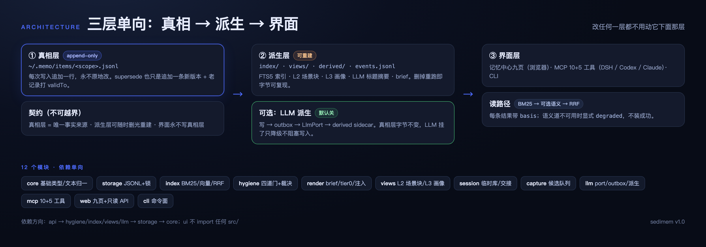

> doc-kind: manual
> doc-version: 1.0

<div align="center">

# sedimem

**本地优先的个人 AI 记忆系统** —— 真相层只追加、永不改写，索引/视图/派生全部可重建，记忆像地层一样沉积。DSH / Codex CLI / Claude Code 三端共用同一个 MCP server。

[](https://github.com/Old-Friends-Gathering/sedimem/actions/workflows/ci.yml)
[](https://github.com/Old-Friends-Gathering/sedimem/actions/workflows/quality.yml)
[](https://github.com/Old-Friends-Gathering/sedimem/actions/workflows/security.yml)
[](https://github.com/Old-Friends-Gathering/sedimem/actions/workflows/pages-verify.yml)

`648 tests` · `eval I1–I50` · `0 runtime deps` · `Node ≥ 22` · `v1.0.2`



真相层不可变 · 派生层可重建 · 界面永不写。

</div>

## 30 秒看懂

**写入**：四道门依次过，过了才追加进真相层。


**检索**：BM25 打底 + 可选语义道，RRF 融合，结果带 basis，语义挂了自动降级不阻断。


## 装到的三个客户端

三端各配一条 stdio MCP，指向同一个 `server.js` 和同一个 `MEMO_HOME`。常驻进程（DSH）记得先 `memory_scope` 对齐分库。

```yaml
# DSH：~/.dsh/profiles/<profile>/cordis.patch.yml
- insert:
    - id: memory-sedimem
      name: '@deepseek-ai/dsh-mcp-client'
      config:
        serverName: memo
        transport: stdio
        command: /opt/homebrew/bin/node
        args: ['/ABS/PATH/versions/v1.0/src/mcp/server.js']
        env: { MEMO_HOME: '$HOME/.memo' }
```

```toml
# Codex CLI：~/.codex/config.toml
[mcp_servers.memo]
command = "/opt/homebrew/bin/node"
args = ["/ABS/PATH/versions/v1.0/src/mcp/server.js"]
enabled = true
[mcp_servers.memo.env]
MEMO_HOME = "$HOME/.memo"
```

```bash
# Claude Code
claude mcp add --scope user memo -e MEMO_HOME=$HOME/.memo -- \
  /opt/homebrew/bin/node /ABS/PATH/versions/v1.0/src/mcp/server.js
```

自检：`bash versions/v1.0/configs/verify-three-clients.sh`（期望 `PASS`）。

## 记忆中心

`memo serve --port 7788`（默认只读；`--write` 才可编辑，token + If-Match）。


| 页 | 干什么 |
|---|---|
| 今日 | 看当天变化 |
| 图谱 | 力导向全貌 |
| 搜索 | 带依据检索 |
| 卫生 | 待裁决清理 |
| 编辑 | 开写模式改 |
| 导入 | 批量结构化 |
| 会话 | 临时库状态 |
| 交接 | 六段交接文 |
| 设置 | 分库与配色 |

## LLM 总结层（可选）

派生只写 sidecar，真相层字节不变；`provider=none` 时整层不存在。


```bash
mkdir -p ~/.config/sedimem && printf '%s\n' '<key>' > ~/.config/sedimem/llm-key && chmod 600 ~/.config/sedimem/llm-key
export MEMO_LLM_PROVIDER=openai-compatible MEMO_LLM_BASE_URL=https://open.bigmodel.cn/api/paas/v4 MEMO_LLM_MODEL=glm-5.3-flash
memo llm status && memo llm test && memo derive --rebuild
```

成本实测（GLM-5.3-Flash）：33 条全量重建 ≈1m50s、**<¥0.02**。

## 会话临时库

探索先进临时库；close 只晋升 decision/gotcha，其余随库废弃。


```bash
memo session start --title "调试锁竞争"
memo session checkpoint --intent "查锁竞争根因"
memo session status
memo session close      # 晋升 + 生成交接文档
memo session sweep      # 扫 14 天僵尸库
```

## 门禁

本地脚本 = CI 脚本；改阈值先改契约，直接改脚本数字会被拦下。


```bash
node tools/quality-check.mjs && node tools/security-check.mjs && node tools/coverage-gate.mjs
```

## 快速开始

```bash
git clone https://github.com/Old-Friends-Gathering/sedimem && cd sedimem
NODE=$(command -v node); V=versions/$(cat versions/CURRENT)

# 1. 写一条
$NODE $V/src/cli/memo.js write --kind fact --title "CI 要求 Node 22+" --text "部署流水线要求 Node 22 及以上" --agent cli
# 2. 检索 + brief
$NODE $V/src/cli/memo.js search "node 版本" && $NODE $V/src/cli/memo.js brief
# 3. 打开记忆中心 http://127.0.0.1:7788
$NODE $V/src/cli/memo.js serve --port 7788
```

## 文档地图

| 文档 | 解决什么 |
|---|---|
| [docs/00](docs/00-principles-and-requirements.md) | 原则与硬需求 |
| [docs/01](docs/01-architecture.md) | 分层与失败模式 |
| [docs/02](docs/02-data-model-and-contract.md) | **数据契约（唯一权威）** |
| [docs/06](docs/06-usage.md) | 三端落位与日常操作 |
| [docs/07](docs/07-quality-and-security.md) | 门禁指标与阈值 |
| [docs/08](docs/08-web-ui.md) | 记忆中心九页规格 |
| [docs/research](docs/research/README.md) | 为什么自建（横评 8 系统） |

## 版本

| 版本 | 主题 | 状态 |
|---|---|---|
| **v1.0.2** | 三处真 fix（思考链/重建/懒加载）+ 文档改图为主 | ✅ 当前 |
| v1.0.1 | 图谱可用性 + 配色对齐 DSH | ✅ 已交付 |
| v1.0.0 | 12 模块重构 + LLM 总结层 + 九页重做 | ✅ 已交付 |
| v0.6.2 | 修 CLI `--scope` 静默失效 | 🔒 冻结 |
| 更早（v0.1–v0.5） | 核心层、语义道、pages-verify 等 | 🔒 冻结 |

`X.Y` 换目录、`X.Y.Z` 同目录补丁；指针在 `versions/CURRENT`。

## FAQ

**要 LLM 吗？** 不要。`provider=none` 默认且完整可用，门禁/检索/brief/图谱全部零 LLM 成本。

**开 LLM 花多少钱？** 可忽略：33 条全量重建 <¥0.02、约 2 分钟；增量 drain 更便宜。

**数据在哪？** 全在 `~/.memo/`，删目录即彻底清除，无任何云组件；不开 LLM 时数据不出本机。

**三端怎么共库？** 各配一条 stdio MCP，指向同一 `server.js`、同一 `MEMO_HOME`；常驻进程先 `memory_scope` 对齐分库。

**能多人用吗？** scope 是分类不是权限边界；多人协作需要独立部署与鉴权，这是刻意不做的。

**和 mem0 / claude-mem 区别？** 它们擅长自动提取；sedimem 重心在治理——三端共用 + as-of 回查 + 真相层不可变 + 投毒可审计。

## 为什么叫 sedimem

`sedi`（沉积）+ `mem`（记忆）：记忆像地层一样沉积，而不是被反复改写覆盖。

真相层是沉积层 —— 只追加；改过去 = 追加新版本；`asOf` 可回看任意时点。

## 许可

[MIT](LICENSE) © 2026 Old Friends Gathering
